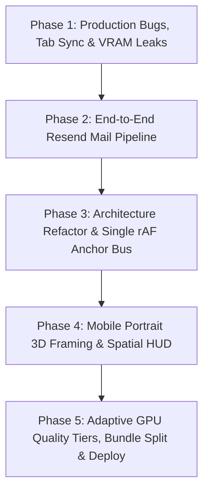
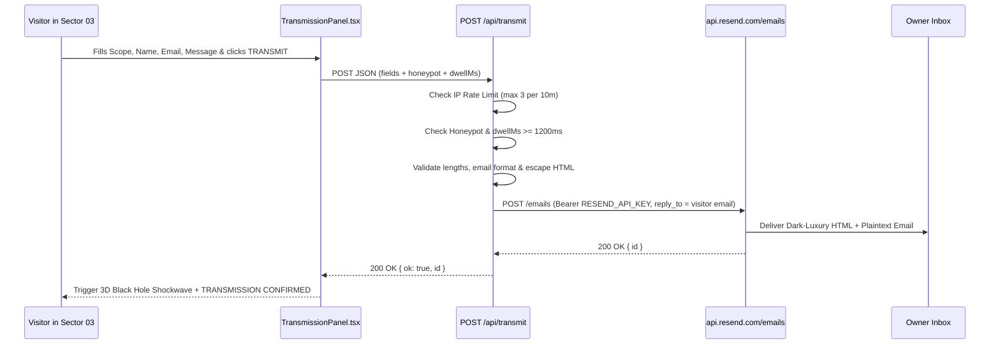

# ENGINEERING PLAN & PRODUCTION RUNBOOK — ALDEBARAN

> [!IMPORTANT]
> **دليل المهندس المنفّذ (Step-by-Step Execution Specification):**
> هذه الوثيقة تمثل المرجع الهندسي الكامل لتجهيز مشروع **ALDEBARAN** للإنتاج والرفع النهائي. كُتبت بناءً على مراجعة فعلية لكل ملف وسطر في المستودع، وقُسّمت إلى **5 مراحل متسلسلة ومهام ذرية مرقّمة** تشمل: التشخيص الدقيق بالملف والسطر، العقود البرمجية والأكواد الجاهزة للتنفيذ، الإحداثيات الرقمية الدقيقة، ومعايير القبول الصارمة.
>
> **القاعدة الذهبية الملزمة:** التصميم والأبعاد والإحداثيات الحالية على شاشات الديسكتوب (`>= 1024px`) معتمدة نهائياً ويجب الحفاظ عليها بنسبة **100%** دون تغيير بكسل واحد أثناء تنفيذ جميع المراحل.

---

## جدول المحتويات

1. [خارطة التنفيذ وترتيب الاعتماديات](#خارطة-التنفيذ-وترتيب-الاعتماديات)
2. [الفهرس التشخيصي للأعطال والمشاكل المكتشفة في الكود الحالي](#الفهرس-التشخيصي-للأعطال-والمشاكل-المكتشفة-في-الكود-الحالي)
3. [المرحلة 1: إصلاح أعطال الإنتاج الجذرية وتزامن التبويبات والذاكرة](#المرحلة-1-إصلاح-أعطال-الإنتاج-الجذرية-وتزامن-التبويبات-والذاكرة)
4. [المرحلة 2: منظومة البريد والتواصل الكاملة عبر Resend وإزالة Supabase](#المرحلة-2-منظومة-البريد-والتواصل-الكاملة-عبر-resend-وإزالة-supabase)
5. [المرحلة 3: إعادة هيكلة المعمارية وتقسيم المكونات الضخمة](#المرحلة-3-إعادة-هيكلة-المعمارية-وتقسيم-المكونات-الضخمة)
6. [المرحلة 4: هندسة تجربة الموبايل الفاخرة Portrait 3D + Spatial HUD](#المرحلة-4-هندسة-تجربة-الموبايل-الفاخرة-portrait-3d--spatial-hud)
7. [المرحلة 5: تسريع الأداء ومستويات GPU التكيفية وتجهيز النشر](#المرحلة-5-تسريع-الأداء-ومستويات-gpu-التكيفية-وتجهيز-النشر)
8. [قائمة الفحص والقبول النهائية قبل الإطلاق Definition of Done](#قائمة-الفحص-والقبول-النهائية-قبل-الإطلاق-definition-of-done)

---

## خارطة التنفيذ وترتيب الاعتماديات



---

## الفهرس التشخيصي للأعطال والمشاكل المكتشفة في الكود الحالي

| المعرّف | الموقع الفعلي في المستودع | التشخيص الهندسي الجذري | المرحلة المعالجة |
| :--- | :--- | :--- | :--- |
| `BUG-01` | [`src/components/space/Experience.tsx`](./src/components/space/Experience.tsx) (الأسطر `17, 26`) و [`src/space/universe.ts`](./src/space/universe.ts) (الأسطر `100, 114, 570-582`) | **خلط المشهد مع الكروت عند تبديل التبويبات:** رقم القطاع محفوظ في مكانين منفصلين (`sector` في React مقابل `currentSector = 0` في `Universe`)، ونهاية `warmupGPU()` تجبر الكاميرا دائماً على العودة للقطاع `0`. عند إعادة تهيئة `Universe` أو استعادة التبويب، يعود مشهد 3D للشمس (`Sector 0`) بينما تظل واجهة React على كروت القطاع `2` (`SystemsPanel`). | المرحلة 1 |
| `BUG-02` | [`src/space/universe.ts`](./src/space/universe.ts) (الأسطر `309-384`) | **تعليق حالة السحب والالتفاف العنيف بعد `Alt+Tab`:** لا يوجد مستمع لأحداث `pointercancel` أو `window.blur` أو `document.visibilitychange`. مغادرة التبويب أثناء السحب تترك `this.press !== null`، ولا تحسم انتقال `warp` المعلّق. | المرحلة 1 |
| `BUG-03` | [`src/space/universe.ts`](./src/space/universe.ts) (الأسطر `130-160`) | **غياب معالجة فقدان سياق WebGL (`webglcontextlost` / `webglcontextrestored`):** عند فتح تبويبات متعددة أو على هواتف iOS/Android يسحب المتصفح سياق الـ GPU لتوفير الذاكرة فيتجمد المشهد أو يتحول لشاشة سوداء دائمة. | المرحلة 1 |
| `BUG-04` | [`src/space/universe.ts`](./src/space/universe.ts) (الأسطر `262-277`) | **تسريب ذاكرة GPU ضخم (`~85 MB` لكل دورة):** الدالة `dispose()` تحرر فقط `aldebaran` و `starClusters`، وتترك `planets` (صورة 4K + 14 مجسم + 8 شيدرات) و `horizon` (صورتين 4K للثقب الأسود = `33.5 MB`) و `starfield` و `skyDome` دون تحرير. | المرحلة 1 |
| `BUG-05` | [`src/space/audio.ts`](./src/space/audio.ts) (الأسطر `24-61, 108-113`) | **استمرار الصوت بالخلفية + تقطيع الفريم عند بدء الـ Warp:** المذبذب الصوتي (`55Hz`) يستمر بالعمل عند مغادرة التبويب أو قفل شاشة الهاتف، ودالة `playWarp()` تنشئ مصفوفة `Float32Array(72000)` وتولّد `72,000` رقم عشوائي على الـ Main Thread في أول فريم للانتقال. | المرحلة 1 |
| `BUG-06` | [`src/components/space/CosmicBootLoader.tsx`](./src/components/space/CosmicBootLoader.tsx) (الأسطر `9, 25`) | **ترميز معطوب `α-TAU` + مؤقت وهمي:** النص يحتوي على خطأ ترميز UTF-8 (`α` بدلاً من `α`)، والعداد يعمل بمؤقت زمني منفصل عن تحميل الخطوط وجاهزية الـ WebGL. | المرحلة 1 |
| `BUG-07` | [`src/components/space/TransmissionPanel.tsx`](./src/components/space/TransmissionPanel.tsx) (الأسطر `62-79`) و [`src/lib/supabase.ts`](./src/lib/supabase.ts) | **اعتماد الفورم على Supabase غير المربوط مع نجاح وهمي محلي:** المطلوب استبداله كلياً بمنظومة بريد احترافية عبر **Resend** وحذف تبعية `@supabase/supabase-js` (`~145 KB`) بالكامل. | المرحلة 2 |
| `BUG-08` | [`ArtifactsPanel.tsx`](./src/components/space/ArtifactsPanel.tsx) (`L90`)، [`SystemsPanel.tsx`](./src/components/space/SystemsPanel.tsx) (`L34, L80`)، [`HorizonPanel.tsx`](./src/components/space/HorizonPanel.tsx) (`L16`) | **حلقات `requestAnimationFrame` مكررة وإعادة Render شاملة:** استدعاء `scene.updateMatrixWorld()` مرتين في كل فريم، واستخدام `setState` داخل `setInterval` يعيد بناء شجرة SVG من مئات العناصر كل `500–750ms` لتحديث أربعة أرقام نصية فقط. | المرحلة 3 |
| `BUG-09` | [`HorizonPanel.tsx`](./src/components/space/HorizonPanel.tsx)، [`ArtifactsPanel.tsx`](./src/components/space/ArtifactsPanel.tsx)، [`SystemsPanel.tsx`](./src/components/space/SystemsPanel.tsx)، [`TransmissionPanel.tsx`](./src/components/space/TransmissionPanel.tsx)، [`Experience.tsx`](./src/components/space/Experience.tsx) (`L248`) | **تدهور التجربة البصرية على الموبايل:** الكروت متراصة عمودياً فوق المشاهد الثلاثية الأبعاد، عنوان `THE FORGE` مرسوم مرتين فوق بعض (HTML فوق 3D)، الكوكب والأسطرلاب مقصوصان يسار الشاشة الطولية (`x = -395` و `-378`)، شريط `SectorNav` يظهر في قطاع `2` فقط، وحقول الفورم بخط `13px` تسبب Zoom قسري في iOS Safari. | المرحلة 4 |
| `BUG-10` | [`src/space/constants.ts`](./src/space/constants.ts) (`L9-10`)، [`universe.ts`](./src/space/universe.ts) (`L541-586`)، [`index.html`](./index.html) (`L12`) | **استنزاف بطارية الموبايل وتجميد التحميل الأولي:** الهواتف الاقتصادية ذات الـ 8 أنوية تُصنَّف كأجهزة مكتبية خارقة (`DPR 2.0` + `160` خطوة Raymarching + Bloom كامل)، وبناء كل المشاهد والصور الـ 4K يتم متزامناً قبل أول رسم للشاشة، وتحميل `36` وزناً من `9` خطوط في `index.html`. | المرحلة 5 |

---

## المرحلة 1: إصلاح أعطال الإنتاج الجذرية وتزامن التبويبات والذاكرة

### المهمة 1.1: بناء مخزن موحّد للحالة ومزامنة الرابط (`src/store/spatialStore.ts`)

**الهدف:** إنهاء ازدواجية الحالة بين React و `Universe` وحفظ القطاع الحالي في رابط الصفحة (`#origin`, `#orbital`, `#forge`, `#uplink`) بحيث يظل القطاع متطابقاً عند تبديل التبويبات أو عمل Reload أو استخدام أزرار التقدم والرجوع في المتصفح.

**خطوات التنفيذ:**
1. أنشئ الملف `src/store/spatialStore.ts` بالكود الكامل التالي (يعتمد على `useSyncExternalStore` المدمج في React 18 بدون أي مكتبات خارجية):

```ts
// src/store/spatialStore.ts
import { useSyncExternalStore } from 'react';

export const SECTOR_SLUGS = ['origin', 'orbital', 'forge', 'uplink'] as const;
export type SectorSlug = (typeof SECTOR_SLUGS)[number];

export interface SpatialState {
  sector: number;
  warpTarget: number | null;
  selectedProject: number | null;
  activeDiscipline: number | null;
  contextLost: boolean;
}

export function readSectorFromHash(): number {
  if (typeof window === 'undefined') return 0;
  const raw = window.location.hash.replace(/^#/, '').trim().toLowerCase();
  const idx = SECTOR_SLUGS.indexOf(raw as SectorSlug);
  return idx >= 0 ? idx : 0;
}

function writeSectorToHash(sector: number): void {
  if (typeof window === 'undefined') return;
  const slug = SECTOR_SLUGS[sector] ?? SECTOR_SLUGS[0];
  const nextHash = `#${slug}`;
  if (window.location.hash !== nextHash) {
    window.history.replaceState(null, '', nextHash);
  }
}

let state: SpatialState = {
  sector: readSectorFromHash(),
  warpTarget: null,
  selectedProject: null,
  activeDiscipline: null,
  contextLost: false,
};

const listeners = new Set<() => void>();
const emit = () => listeners.forEach((fn) => fn());

export const spatialStore = {
  getState(): SpatialState {
    return state;
  },
  subscribe(listener: () => void): () => void {
    listeners.add(listener);
    return () => listeners.delete(listener);
  },
  startWarp(target: number): void {
    if (target < 0 || target >= SECTOR_SLUGS.length) return;
    state = {
      ...state,
      warpTarget: target,
      selectedProject: null,
      activeDiscipline: null,
    };
    writeSectorToHash(target);
    emit();
  },
  arriveSector(sector: number): void {
    state = { ...state, sector, warpTarget: null };
    writeSectorToHash(sector);
    emit();
  },
  syncInstant(sector: number): void {
    state = {
      ...state,
      sector,
      warpTarget: null,
      selectedProject: null,
      activeDiscipline: null,
    };
    writeSectorToHash(sector);
    emit();
  },
  setSelectedProject(selectedProject: number | null): void {
    if (state.selectedProject === selectedProject) return;
    state = { ...state, selectedProject };
    emit();
  },
  setActiveDiscipline(activeDiscipline: number | null): void {
    if (state.activeDiscipline === activeDiscipline) return;
    state = { ...state, activeDiscipline };
    emit();
  },
  setContextLost(contextLost: boolean): void {
    if (state.contextLost === contextLost) return;
    state = { ...state, contextLost };
    emit();
  },
};

export function useSpatialStore<T>(selector: (s: SpatialState) => T): T {
  return useSyncExternalStore(
    spatialStore.subscribe,
    () => selector(spatialStore.getState()),
    () => selector(spatialStore.getState()),
  );
}
```

---

### المهمة 1.2: تمرير `initialSector` ومعالجة `visibilitychange` و `pointercancel` و `webglcontextlost` في `Universe`

**الملف المستهدف:** [`src/space/universe.ts`](./src/space/universe.ts)

**خطوات التنفيذ:**
1. عدّل توقيع `constructor` ليقبل `initialSector = 0`:
   - اضبط `this.currentSector = initialSector;`
   - اضبط `this.camPos.copy(this.cameraFor(initialSector));` و `this.lookPos.copy(sectorCenter(initialSector));`
   - في نهاية `warmupGPU()` (الأسطر `569-582`)، أزل الأسطر التي تعيد الضبط قسراً إلى `0` واستبدلها بالعودة إلى `this.currentSector` وتمرير الوزن `this.currentSector === idx ? 1.0 : 0.0` لكل مشهد.
2. أضف الدالة `jumpInstant(index: number)` داخل `Universe`:
```ts
jumpInstant(index: number): void {
  if (index < 0 || index >= SECTORS.length) return;
  this.warp = null;
  this.warpIntensity = 0;
  this.currentSector = index;
  this.focusIndex = null;
  this.yaw = 0;
  this.pitch = 0;
  this.targetYaw = 0;
  this.targetPitch = 0;
  this.velocityYaw = 0;
  this.velocityPitch = 0;
  this.camPos.copy(this.cameraFor(index));
  this.lookPos.copy(sectorCenter(index));
  this.camera.up.set(0, 1, 0);
}
```
3. اربط مستمع `window.addEventListener('hashchange', ...)` بحيث إذا غيّر المستخدم الرابط أو ضغط زر الرجوع في المتصفح يستدعي `universe.jumpInstant(readSectorFromHash())` و `spatialStore.syncInstant(...)`.
4. أضف مستمعات حماية التبويب والسياق داخل `Universe` (مع إزالتها في `dispose()`):
   - `container.addEventListener('pointercancel', this.resetInteraction)` و `window.addEventListener('blur', this.resetInteraction)`: تصفير `this.press = null`، `this.velocityYaw = 0`، `this.velocityPitch = 0`، واستدعاء `this.aldebaran.onDragEnd()`.
   - `document.addEventListener('visibilitychange', this.handleVisibilityChange)`:
     - إذا كانت `document.hidden === true`: أوقف `cancelAnimationFrame(this.frameId); this.frameId = 0;`، استدعِ `this.resetInteraction()`، أوقف الصوت مؤقتاً `suspendAudioForBackground(true)`، وإذا كان `this.warp !== null` احسم الانتقال فوراً: `const target = this.warp.target; this.jumpInstant(target); this.callbacks.onArrive(target);`.
     - إذا كانت `document.hidden === false`: حدّث `this.lastFrame = performance.now();`، استأنف الصوت `suspendAudioForBackground(false)`، وأعد تشغيل الحلقة `if (!this.frameId && !this.isContextLost) this.frameId = requestAnimationFrame(this.frame);`.
   - `this.renderer.domElement.addEventListener('webglcontextlost', ...)` و `'webglcontextrestored'`:
     - عند الفقدان: استدعِ `event.preventDefault()`، اضبط `this.isContextLost = true`، أوقف حلقة الرسم، وبلّغ `spatialStore.setContextLost(true)`.
     - عند الاستعادة: اضبط `this.isContextLost = false`، استدعِ `refreshTextures()` لجميع المشاهد لإعادة رفع الـ `CanvasTexture`s إلى GPU، واضبط `spatialStore.setContextLost(false)`، وأعد تشغيل حلقة الرسم على نفس `this.currentSector`.

---

### المهمة 1.3: إغلاق تسريبات ذاكرة الـ GPU (`dispose()` و `refreshTextures()`)

**الملفات المستهدفة:**
- [`src/space/planetSystem.ts`](./src/space/planetSystem.ts)
- [`src/space/blackHole.ts`](./src/space/blackHole.ts)
- [`src/space/starClusters.ts`](./src/space/starClusters.ts)
- [`src/space/starField.ts`](./src/space/starField.ts)
- [`src/space/skyDome.ts`](./src/space/skyDome.ts)
- [`src/space/universe.ts`](./src/space/universe.ts)

**خطوات التنفيذ:**
1. في `planetSystem.ts`: أضف `refreshTextures()` (`bannerTexture.needsUpdate = true`) ودالة `dispose()` تمر عبر `group.traverse` لتحرير جميع الـ `BufferGeometry` والـ `Material` و `bannerTexture.dispose()`.
2. في `blackHole.ts`: أضف `refreshTextures()` التي تعيد استدعاء `draw()` لرفع `qTex` و `uTex`، ودالة `dispose()` التي تحرر `lensPlane.geometry`، `lensPlane.material`، `qMesh.geometry`، `qMat`، `qTex`، `uMesh.geometry`، `uMat`، `uTex`.
3. في `starClusters.ts`: أضف في `dispose()` تحرير `stardust.object.geometry.dispose()` و `stardust.material.dispose()`، وأضف `refreshTextures()` (`theForgeTitle.texture.needsUpdate = true`).
4. في `starField.ts` و `skyDome.ts`: أضف دالة `dispose()` تحرر الهندسة والماتيريال.
5. في `universe.ts`: استدعِ `dispose()` لجميع المشاهد الستة داخل `Universe.dispose()`.

---

### المهمة 1.4: إصلاح الصوت في الخلفية وإلغاء تخصيص الذاكرة المتكرر في `playWarp()`

**الملف المستهدف:** [`src/space/audio.ts`](./src/space/audio.ts)

**خطوات التنفيذ:**
1. احفظ مخزن الضوضاء البيضاء `cachedNoiseBuffer: AudioBuffer | null` ليبنى مرة واحدة فقط عند أول تفاعل ويعاد استخدامه في كل استدعاء لـ `playWarp()` بدلاً من حلقة `72,000` تكرار في بداية كل انتقال.
2. أضف وصَدِّر الدالة `suspendAudioForBackground(hidden: boolean)` لتعليق `context.suspend()` فور إخفاء التبويب أو قفل شاشة الهاتف، واستئنافه `context.resume()` عند العودة (ما لم يكن المستخدم قد كتم الصوت يدوياً `isMuted === true`).

---

### المهمة 1.5: إصلاح ترميز `CosmicBootLoader.tsx` وحذف المكون القديم غير المستخدم

**الملفات المستهدفة:** [`src/components/space/CosmicBootLoader.tsx`](./src/components/space/CosmicBootLoader.tsx)

**خطوات التنفيذ:**
1. استبدل السطر `9` المعطوب `'COMPILING 26,000 STELLAR BODIES [ALDEBARAN α-TAU]'` بـ `'COMPILING 26,000 STELLAR BODIES [ALDEBARAN \u03B1-TAU]'`.
2. اربط اكتمال شريط التحميل (`100%`) بشرط `engineReady && fontsReady` مع حد أقصى أمان (`2600ms` timeout fallback) حتى لا تفتح الواجهة قبل استقرار الخطوط والشيدر الابتدائي.
3. إذا وُجد الملف القديم غير المستورد `src/components/space/Astrolabe.tsx` محلياً، احذفه نهائياً وأزل إشارته من `.gitignore`.

---

## المرحلة 2: منظومة البريد والتواصل الكاملة عبر Resend وإزالة Supabase

> [!IMPORTANT]
> **لماذا يجب أن يمر Resend عبر Serverless Endpoint (`/api/transmit`) وليس من المتصفح مباشرة؟**
> 1. مفتاح `RESEND_API_KEY` سري بالكامل؛ وضعه في كود الواجهة (`VITE_...`) يكشفه لأي زائر يفتح DevTools.
> 2. خوادم `api.resend.com` ترفض طلبات المتصفح المباشرة عبر سياسة CORS.
> لذلك نبني دالة خادم خفيفة جداً (`POST /api/transmit`) تعمل بنفس الكود القياسي (`Web Fetch Request/Response`) على **Vercel** أو **Cloudflare Pages** أو **Netlify**، مع تضمين وسيط محلي في `vite.config.ts` لتجربتها محلياً أثناء `npm run dev` مباشرةً.



### المهمة 2.1: إزالة Supabase وتحديث متغيرات البيئة

**خطوات التنفيذ:**
1. نفّذ الأمر:
   ```bash
   npm uninstall @supabase/supabase-js
   ```
2. احذف الملف `src/lib/supabase.ts` ومجلد `supabase/` (لا حاجة لهما في هذه النسخة، مما يوفر `~145 KB` من حجم الحزمة).
3. حدّث ملف [`.env.example`](./.env.example) ليصبح كالتالي (لاحظ عدم وجود بادئة `VITE_` نهائياً لحماية المفاتيح على الخادم فقط):
   ```env
   # Server-side Resend configuration (NEVER prefix with VITE_)
   RESEND_API_KEY=re_your_api_key_here
   TRANSMISSION_TO_EMAIL=ebrahimkordy0@gmail.com
   TRANSMISSION_FROM_EMAIL=Aldebaran Studio <onboarding@resend.dev>
   ```
   - **للتجربة الفورية بدون دومين:** اترك `TRANSMISSION_FROM_EMAIL` على `onboarding@resend.dev` وسيوصل Resend الرسائل فوراً إلى بريد حسابك المسجّل في Resend.
   - **عند ربط دومين رسمي للإنتاج:** من لوحة تحكم Resend -> **Domains** -> أضف دومينك -> انسخ سجلات `SPF` و `DKIM` (`TXT` / `MX`) إلى مزود الدومين -> غيّر العنوان إلى `Aldebaran Studio <uplink@yourdomain.com>`.

---

### المهمة 2.2: إنشاء عقود البيانات المشتركة (`src/types/transmission.ts`)

أنشئ الملف `src/types/transmission.ts` بالكود التالي:

```ts
// src/types/transmission.ts
export const TRANSMISSION_SCOPES = ['software', 'uiux', 'identity', 'other'] as const;
export type TransmissionScope = (typeof TRANSMISSION_SCOPES)[number];

export const SCOPE_LABELS: Record<TransmissionScope, string> = {
  software: 'Software Architecture',
  uiux: 'Spatial & Product Interface',
  identity: 'Brand & Motion Identity',
  other: 'Custom / Advisory',
};

export interface TransmissionPayload {
  scope: TransmissionScope;
  name: string;
  email: string;
  message: string;
  companyWebsite?: string; // Honeypot trap (must remain empty)
  dwellMs?: number;        // Time elapsed since form mount in ms
}

export type TransmissionResponse =
  | { ok: true; id: string }
  | {
      ok: false;
      code: 'VALIDATION_ERROR' | 'RATE_LIMITED' | 'CONFIG_ERROR' | 'UPSTREAM_ERROR';
      error: string;
    };
```

---

### المهمة 2.3: بناء معالج الإرسال الخادمي وقالب البريد (`api/_lib/sendTransmission.ts` و `api/transmit.ts`)

1. أنشئ الملف `api/_lib/sendTransmission.ts`:

```ts
// api/_lib/sendTransmission.ts
import {
  SCOPE_LABELS,
  TRANSMISSION_SCOPES,
  type TransmissionPayload,
  type TransmissionResponse,
  type TransmissionScope,
} from '../../src/types/transmission';

const EMAIL_REGEX = /^[^\s@]+@[^\s@]+\.[^\s@]{2,}$/;
const ipHits = new Map<string, number[]>();
const WINDOW_MS = 10 * 60 * 1000;
const MAX_HITS = 3;

function isRateLimited(ip: string): boolean {
  const now = Date.now();
  const recent = (ipHits.get(ip) ?? []).filter((t) => now - t < WINDOW_MS);
  if (recent.length >= MAX_HITS) {
    ipHits.set(ip, recent);
    return true;
  }
  recent.push(now);
  ipHits.set(ip, recent);
  return false;
}

function escapeHtml(input: string): string {
  return input
    .replace(/&/g, '&amp;')
    .replace(/</g, '&lt;')
    .replace(/>/g, '&gt;')
    .replace(/"/g, '&quot;')
    .replace(/'/g, '&#39;');
}

function renderEmailHtml(params: {
  scopeLabel: string;
  name: string;
  email: string;
  message: string;
  timestampIso: string;
}): string {
  const safeScope = escapeHtml(params.scopeLabel);
  const safeName = escapeHtml(params.name);
  const safeEmail = escapeHtml(params.email);
  const safeMessage = escapeHtml(params.message).replace(/\r?\n/g, '<br />');

  return `<!DOCTYPE html>
<html lang="en">
  <body style="margin:0;padding:32px 16px;background-color:#030407;color:#ECE8E1;font-family:-apple-system,BlinkMacSystemFont,'Segoe UI',Roboto,Helvetica,Arial,sans-serif;">
    <table role="presentation" width="100%" cellspacing="0" cellpadding="0" style="max-width:600px;margin:0 auto;background-color:#080B13;border:1px solid #262A36;border-radius:12px;overflow:hidden;">
      <tr>
        <td style="padding:24px 28px;border-bottom:1px solid #1C202B;background-color:#0B0F1A;">
          <div style="font-family:monospace;font-size:11px;letter-spacing:2.4px;color:#EAC078;text-transform:uppercase;">
            ALDEBARAN // DIRECT QUANTUM UPLINK
          </div>
          <h1 style="margin:8px 0 0;font-size:22px;font-weight:500;color:#FAF8F4;">
            New Project Inquiry
          </h1>
        </td>
      </tr>
      <tr>
        <td style="padding:24px 28px;">
          <table role="presentation" width="100%" cellspacing="0" cellpadding="0" style="margin-bottom:20px;background-color:#05070D;border:1px solid #181C26;border-radius:8px;">
            <tr>
              <td style="padding:12px 16px;border-bottom:1px solid #141821;">
                <span style="font-family:monospace;font-size:10px;letter-spacing:1.5px;color:#8E929F;text-transform:uppercase;display:block;">SCOPE</span>
                <span style="font-size:14px;color:#FBF2D5;font-weight:600;">${safeScope}</span>
              </td>
            </tr>
            <tr>
              <td style="padding:12px 16px;border-bottom:1px solid #141821;">
                <span style="font-family:monospace;font-size:10px;letter-spacing:1.5px;color:#8E929F;text-transform:uppercase;display:block;">SENDER</span>
                <span style="font-size:14px;color:#FAF8F4;">${safeName}</span>
              </td>
            </tr>
            <tr>
              <td style="padding:12px 16px;">
                <span style="font-family:monospace;font-size:10px;letter-spacing:1.5px;color:#8E929F;text-transform:uppercase;display:block;">REPLY-TO EMAIL</span>
                <a href="mailto:${safeEmail}" style="font-size:14px;color:#C5F1FA;text-decoration:none;">${safeEmail}</a>
              </td>
            </tr>
          </table>

          <div style="font-family:monospace;font-size:10px;letter-spacing:1.5px;color:#8E929F;text-transform:uppercase;margin-bottom:8px;">
            MESSAGE PAYLOAD
          </div>
          <div style="padding:18px;background-color:#05070D;border:1px solid #181C26;border-radius:8px;font-size:14px;line-height:1.65;color:#E6E2DA;">
            ${safeMessage}
          </div>

          <div style="margin-top:20px;font-family:monospace;font-size:10px;color:#6E7382;">
            RECEIVED AT ${params.timestampIso} &bull; Reply directly to this email to contact ${safeName}.
          </div>
        </td>
      </tr>
    </table>
  </body>
</html>`;
}

export async function processTransmission(
  body: unknown,
  clientIp: string,
  env: Record<string, string | undefined>,
): Promise<{ status: number; json: TransmissionResponse }> {
  if (isRateLimited(clientIp)) {
    return {
      status: 429,
      json: { ok: false, code: 'RATE_LIMITED', error: 'Too many submissions. Please wait a few minutes.' },
    };
  }

  if (!body || typeof body !== 'object') {
    return { status: 400, json: { ok: false, code: 'VALIDATION_ERROR', error: 'Invalid request body.' } };
  }

  const payload = body as Partial<TransmissionPayload>;

  // Silent drop for automated bots filling hidden honeypot or submitting in < 1.2s
  if (
    (typeof payload.companyWebsite === 'string' && payload.companyWebsite.trim() !== '') ||
    (typeof payload.dwellMs === 'number' && payload.dwellMs < 1200)
  ) {
    return { status: 200, json: { ok: true, id: 'filtered' } };
  }

  const scope: TransmissionScope = TRANSMISSION_SCOPES.includes(payload.scope as TransmissionScope)
    ? (payload.scope as TransmissionScope)
    : 'software';
  const name = typeof payload.name === 'string' ? payload.name.trim() : '';
  const email = typeof payload.email === 'string' ? payload.email.trim() : '';
  const message = typeof payload.message === 'string' ? payload.message.trim() : '';

  if (name.length < 1 || name.length > 80) {
    return { status: 400, json: { ok: false, code: 'VALIDATION_ERROR', error: 'Enter your name (1–80 chars).' } };
  }
  if (email.length < 5 || email.length > 120 || !EMAIL_REGEX.test(email)) {
    return { status: 400, json: { ok: false, code: 'VALIDATION_ERROR', error: 'Enter a valid email address.' } };
  }
  if (message.length < 10 || message.length > 2000) {
    return {
      status: 400,
      json: { ok: false, code: 'VALIDATION_ERROR', error: 'Your message needs 10 to 2,000 characters.' },
    };
  }

  const apiKey = env.RESEND_API_KEY?.trim();
  const toEmail = env.TRANSMISSION_TO_EMAIL?.trim();
  const fromEmail = env.TRANSMISSION_FROM_EMAIL?.trim() || 'Aldebaran Studio <onboarding@resend.dev>';

  if (!apiKey || !toEmail) {
    return {
      status: 503,
      json: {
        ok: false,
        code: 'CONFIG_ERROR',
        error: 'Transmission relay is not configured on the server.',
      },
    };
  }

  const scopeLabel = SCOPE_LABELS[scope];
  const timestampIso = new Date().toISOString();

  try {
    const response = await fetch('https://api.resend.com/emails', {
      method: 'POST',
      headers: {
        Authorization: `Bearer ${apiKey}`,
        'Content-Type': 'application/json',
      },
      body: JSON.stringify({
        from: fromEmail,
        to: [toEmail],
        reply_to: email,
        subject: `[ALDEBARAN // ${scope.toUpperCase()}] Inquiry from ${name}`,
        html: renderEmailHtml({ scopeLabel, name, email, message, timestampIso }),
        text: `ALDEBARAN // NEW INQUIRY\nScope: ${scopeLabel}\nName: ${name}\nEmail: ${email}\nTime: ${timestampIso}\n\n${message}`,
      }),
    });

    const result = (await response.json().catch(() => ({}))) as { id?: string };

    if (!response.ok || !result.id) {
      return {
        status: 502,
        json: { ok: false, code: 'UPSTREAM_ERROR', error: 'Mail relay rejected dispatch. Please try again.' },
      };
    }

    return { status: 200, json: { ok: true, id: result.id } };
  } catch {
    return {
      status: 502,
      json: { ok: false, code: 'UPSTREAM_ERROR', error: 'Network error while dispatching transmission.' },
    };
  }
}
```

2. أنشئ نقطة النهاية القياسية `api/transmit.ts`:

```ts
// api/transmit.ts
import { processTransmission } from './_lib/sendTransmission';

export const config = {
  runtime: 'edge',
};

export default async function handler(request: Request): Promise<Response> {
  if (request.method !== 'POST') {
    return new Response(JSON.stringify({ ok: false, error: 'Method Not Allowed' }), {
      status: 405,
      headers: { 'Content-Type': 'application/json', Allow: 'POST' },
    });
  }

  const ip =
    request.headers.get('x-forwarded-for')?.split(',')[0]?.trim() ||
    request.headers.get('x-real-ip') ||
    'unknown';

  const body = await request.json().catch(() => null);
  const env =
    (globalThis as unknown as { process?: { env?: Record<string, string | undefined> } }).process?.env ?? {};
  const result = await processTransmission(body, ip, env);

  return new Response(JSON.stringify(result.json), {
    status: result.status,
    headers: { 'Content-Type': 'application/json; charset=utf-8' },
  });
}
```

3. أضف وسيط التطوير المحلي داخل [`vite.config.ts`](./vite.config.ts) عبر `server.middlewares.use('/api/transmit', ...)` مع `loadEnv(mode, process.cwd(), '')` حتى يعمل الإرسال الفعلي أثناء `npm run dev` بنفس المنطق 100%.

---

### المهمة 2.4: ربط `TransmissionPanel.tsx` بـ `/api/transmit`

**الملفات المستهدفة:** `src/lib/transmitClient.ts` و [`src/components/space/TransmissionPanel.tsx`](./src/components/space/TransmissionPanel.tsx)

**خطوات التنفيذ:**
1. أنشئ `src/lib/transmitClient.ts` يرسل `POST /api/transmit` مع `AbortController` بمهلة `12000ms` ويعيد `TransmissionResponse`.
2. في `TransmissionPanel.tsx`:
   - أزل استيراد `supabase` وأزل أي `setTimeout` وهمي.
   - احسب `dwellMs: Date.now() - mountedAtRef.current` وأرسله مع حقل `companyWebsite` المخفي (`tabIndex={-1}`, `aria-hidden="true"`, خارج الشاشة).
   - لا تطلق موجة الصدمة `onBroadcast()` ولا تفرغ الحقول إلا بعد عودة `res.ok === true` فعلياً من الخادم. وفي حالة الخطأ اعرض `res.error` بوضوح مع الاحتفاظ بمدخلات المستخدم.

---

## المرحلة 3: إعادة هيكلة المعمارية وتقسيم المكونات الضخمة

> [!NOTE]
> تُنفَّذ هذه المرحلة مع الحفاظ التام على الشكل الحالي للديسكتوب (`0` فرق بصري)، وتهدف إلى إنهاء الـ God Classes (`universe.ts` بـ `588` سطراً، و `SystemsPanel.tsx` بـ `739` سطراً) وإلغاء الحلقات والمؤقتات المكررة.

### المهمة 3.1: الهيكل المعماري المستهدف للمجلدات

```text
src/
├── store/
│   └── spatialStore.ts                 # مصدر الحقيقة الموحّد للقطاعات وحالة WebGL
├── content/
│   ├── sectors.ts                      # بيانات القطاعات الأربعة وإعدادات الكاميرا (Desktop + Portrait)
│   ├── projects.ts                     # بيانات المشاريع الخمسة ومدارات الأقمار
│   └── forgeDisciplines.ts             # بيانات تخصصات The Forge والمؤشرات الهندسية
├── engine/
│   ├── types.ts                        # العقود الموحّدة: SectorScene, FrameContext, QualityTier
│   ├── quality.ts                      # تصنيف العتاد ومراقب الـ FPS التكيفي
│   ├── anchorBus.ts                    # إسقاط النقاط 3D->2D مرة واحدة في الفريم بدون rAF إضافي
│   ├── CameraController.ts             # حركة الكاميرا، منحنيات الـ Warp، التمايل، وتأطير الموبايل
│   ├── InputController.ts              # الماوس، العجلة، السحب، اللمس، والكيبورد
│   ├── UniverseEngine.ts               # المنسق الرئيسي الرشيق (< 200 سطر)
│   └── scenes/
│       ├── origin/                     # buildMainStar.ts + sunShaders.ts
│       ├── orbital/                    # buildPlanetSystem.ts + planetShaders.ts + moonOrbits.ts
│       ├── forge/                      # buildForgeScene.ts + forgeAstrolabe.ts + astrolabeGeometry.ts + forgeNebulaShaders.ts
│       └── uplink/                     # buildBlackHole.ts + blackHoleShaders.ts + splitTitlePlanes.ts
├── components/
│   ├── primitives/
│   │   ├── ForgeCard.tsx               # البطاقة الزجاجية المزدوجة بحواف الشامبين
│   │   ├── ForgeWell.tsx               # التجويف البصري الداكن الغائر
│   │   ├── LiveReadout.tsx             # تحديث الأرقام الحية عبر ref.textContent مباشرة (0 React Re-renders)
│   │   └── RadarDial.tsx               # أقراص الرادار الفلكية الموحدة بزاوية 45° (بدون أي علامة +)
│   ├── layout/
│   │   ├── GlobalHeader.tsx            # الهيدر الثابت وقائمة القطاعات السريعة
│   │   ├── SectorNav.tsx               # شريط التنقل السفلي الموحّد
│   │   ├── ContextRecoveryBanner.tsx   # تنبيه أنيق عند استعادة WebGL Context
│   │   ├── CosmicBootLoader.tsx
│   │   └── CosmicCursor.tsx
│   └── sectors/
│       ├── origin/                     # HorizonDesktop.tsx + HorizonMobile.tsx + HorizonPanel.tsx
│       ├── orbital/                    # ArtifactsDesktop.tsx + ArtifactsMobile.tsx + ProjectDrawer.tsx + ArtifactsPanel.tsx
│       ├── forge/                      # SystemsDesktop.tsx + SystemsMobile.tsx + pods/ (5 وحدات مستقلة) + SystemsPanel.tsx
│       └── uplink/                     # TransmissionDesktop.tsx + TransmissionMobile.tsx + useTransmissionForm.ts + TransmissionPanel.tsx
├── hooks/
│   ├── useViewportMode.ts              # يكشف isMobile (< 1024px) و isPortrait و reducedMotion
│   └── useAnchorSubscription.ts        # ربط عناصر SVG بحافلة anchorBus بسرعة 60fps
├── lib/
│   └── transmitClient.ts
└── types/
    └── transmission.ts
```

---

### المهمة 3.2: توحيد عقد المشاهد (`SectorScene`) وتحديث القطاع النشط فقط

1. طبّق واجهة موحّدة `SectorScene` لجميع المشاهد الأربعة (`id`, `group`, `update(ctx)`, `setQuality(tier)`, `refreshTextures()`, `dispose()`).
2. داخل `UniverseEngine.updateScene(dt)`: إذا كان `sectorWeight(scene.id) <= 0.001`، اضبط `scene.group.visible = false` وتخطَّ استدعاء `scene.update()` بالكامل (فلا يعمل في الفريم الواحد إلا المشهد الظاهر فعلياً أمام المستخدم).

---

### المهمة 3.3: حافلة الإسقاط الواحدة (`anchorBus.ts`) ومكوّن `LiveReadout.tsx`

1. احذف حلقات `requestAnimationFrame` المستقلة من `ArtifactsPanel.tsx` و `SystemsPanel.tsx`.
2. في نهاية `UniverseEngine.frame()` — بعد تحديث الكاميرا والمشهد النشط مرة واحدة فقط — يقوم المحرك بحساب إحداثيات الشاشة للنقاط المطلوبة للقطاع النشط وبثّها عبر `anchorBus.publish(...)` لتحديث خصائص الـ SVG (`x1, y1, cx, cy, points`) مباشرةً في نفس الفريم دون أي استدعاء مكرر لـ `scene.updateMatrixWorld()`.
3. استبدل `setInterval` + `useState` في `HorizonPanel.tsx` و `SystemsPanel.tsx` بمكوّن `<LiveReadout />` يحدّث `spanRef.current.textContent` مباشرة بدون التسبب في أي React Re-render لشجرة الكروت والـ SVG.

---

## المرحلة 4: هندسة تجربة الموبايل الفاخرة (Portrait 3D + Spatial HUD)

> [!CAUTION]
> **ضوابط صارمة لتجربة الموبايل (`< 1024px`):**
> - **الديسكتوب (`>= 1024px` / `lg:`) مقفل 100%:** لا يُعدَّل أي موضع أو حجم على الديسكتوب.
> - **ممنوع رصّ الكروت عمودياً فوق المشهد:** الثلثان العلويان من شاشة الهاتف (`10%` إلى `68%` من الارتفاع) مخصصان بالكامل للمشهد الثلاثي الأبعاد بعد إعادة تأطير الكاميرا والمجسمات للوضع الطولي (`aspect < 0.95`).
> - **كبسولة زجاجية واحدة بالأسفل:** تعرض كرتاً واحداً نشطاً في كل لحظة داخل شريط أفقي قابل للسحب (`Snap Carousel`) متصل حياً بالمشهد الثلاثي الأبعاد.

### المهمة 4.1: الغلاف العام للموبايل والتنقل باللمس

1. **إظهار `SectorNav` في جميع القطاعات على الموبايل:** عدّل شرط العرض في `Experience.tsx` بحيث يظهر `<SectorNav />` دائماً على الشاشات `< 1024px` في القطاعات `0, 1, 2, 3` مع مراعاة الحافة الآمنة `bottom-[max(0.75rem,env(safe-area-inset-bottom))]`، ويظل مقتصراً على القطاع `2` في الديسكتوب (`>= 1024px`).
2. **قصر `cursor-none` على أجهزة الماوس الحقيقية:** عبر `@media (pointer: fine)` في `src/index.css`.
3. **تحسين حساسية السحب باللمس (Touch Swipe):** تخفيض عتبة `SWIPE_DISTANCE` على اللمس من `70px` إلى `44px`، والسماح بالتنقل بالسحب الأفقي أو العمودي فوق مساحة المسرح الفضائي بالكامل.

---

### المهمة 4.2: جدول إحداثيات التأطير الطولي للـ 3D (`isPortrait = camera.aspect < 0.95`)

يتم التبديل بسلاسة عبر `MathUtils.lerp` عندما تكون نسبة أبعاد الكاميرا `aspect < 0.95` فقط:

| القطاع | الوحدة البرمجية | إعداد الديسكتوب (يبقى دون تغيير) | إعداد الوضع الطولي للموبايل (`aspect < 0.95`) | الهدف البصري على الهاتف |
| :--- | :--- | :--- | :--- | :--- |
| `00` Origin | `mainStar.ts` | `cy = 0.5 * projected.y`, `sc = 1.0` | `cy = 0.5 * projected.y + 0.09`, `sc = Math.min(0.88, aspect * 1.48)` | رفع الشمس المتوهجة وهالتها للثلث العلوي-الأوسط (`y ≈ 38%`) بعيداً عن الأزرار والنصوص السفلية. |
| `01` Orbital | `planetSystem.ts` | `PLANET_OFFSET = (-395, 10, 0)` | `PORTRAIT_PLANET_OFFSET = (-18, 175, 120)` + تحجيم لوحة `SELECTED WORK` لعرض `8%..92%` | توسيط الكوكب ذي الحلقات والأقمار الخمسة في النصف العلوي للشاشة (`y: 16%..54%`) ومنع انقصاصه يساراً. |
| `02` The Forge | `starClusters.ts` | `ASTROLABE_OFFSET = (-378, -118, 115)` | `PORTRAIT_ASTROLABE_OFFSET = (0, -92, 165)` مع `scale = 0.76`، وعنوان `THE / FORGE` بعرض `8%..92%` وارتفاع `y: 22%..43%` | ظهور السديم وعنوان `THE FORGE` الـ 3D في الأعلى، وتحته مباشرة في وسط الشاشة (`y: 46%..65%`) الأسطرلاب المعدني كاملاً. |
| `03` Uplink | `blackHole.ts` | `BH_OFFSET = (175, 95, 0)` | `PORTRAIT_BH_OFFSET = (18, 165, 90)`، وتوسيع لوحتي `QUANTUM UPLINK` إلى `x: 4%..96%, y: 15%..27%` | توسيط الثقب الأسود وقرص البلازما الملتف في النصف العلوي (`y: 14%..52%`) بكامل انحناء الضوء وتداخل العنوان. |

---

### المهمة 4.3: مواصفات واجهة الموبايل لكل قطاع (`< 1024px`)

1. **القطاع `00` (`HorizonMobile.tsx`):**
   - إظهار حلقة الرصد الفلكي المحيطة بالشمس بحجم `w-[76vw] h-[76vw] max-w-[320px]` متمركزة مع موقع الشمس الجديد عند `top-[38%]` مع القوسين الذهبيين المتحركين.
   - شريط قياس أحادي السطر فوق منطقة العنوان (`SYS: ACTIVE // VEL: 14.5 KM/S // 42°58'N`).
   - صف سفلي متوازن (`bottom-[70px] inset-x-5 flex items-end justify-between gap-3`): زر `EXPLORE` الذهبي الدائري (`88×88px`) يساراً، وعنوان `ALDEBARAN` مع `EXPLORE THE COSMOS / REDEFINING SPATIAL REALITY` (`clamp(1.35rem, 5.6vw, 1.85rem)`) يميناً — بدون أي تداخل حتى على عرض `320px`.

2. **القطاع `01` (`ArtifactsMobile.tsx`):**
   - حذف القائمة العمودية ذات الـ `45vh` بالكامل.
   - وضع كاروسيل أفقي واحد (`bottom-[68px]`, ارتفاع `138px`, `snap-x snap-mandatory overflow-x-auto`) يعرض بطاقة `.forge-card` واحدة لكل مشروع (`w-[84vw] max-w-[340px] snap-center`) تضم الكود والاسم والمقياسين الهندسيين وزر `DETAILS`.
   - ربط السحب الأفقي عبر `IntersectionObserver` (`threshold: 0.65`) بدالة `onSelect(index)` لتحريك الكاميرا تلقائياً نحو القمر المقابل ورسم خط المؤشر المنقط الحي من أعلى البطاقة إلى القمر في السماء العلوية.

3. **القطاع `02` (`SystemsMobile.tsx`):**
   - حذف عنوان HTML المكرر (`sm:hidden`) الذي كان يركب فوق عنوان `THE FORGE` الثلاثي الأبعاد، وحذف الشبكة العمودية ذات الـ 3 كروت المتراصة.
   - وضع ترويسة مدمجة أعلى اليسار (`top-[64px]`: `02 // THE FORGE` + `Engineering at astronomical scale.`).
   - وضع كاروسيل أفقي بارتفاع `148px` (`bottom-[68px]`) يضم 3 بطاقات `.forge-card` حقيقية تحتوي على الرسوم الهندسية المتحركة داخل `.forge-well` (موجات التداخل لـ `High-Compute Engines`، مضاعف الألياف الضوئية لـ `Cinematic Interfaces`، ومحاور الأسطرلاب `GIMBAL LOCK` لـ `Sensory Identity`)، بحيث يفعّل السحب بينها `onDisciplineChange(0 | 1 | 2)` لتسريع وإضاءة الحلقة المقابلة في الأسطرلاب المعدني المتمركز فوقها مباشرةً.

4. **القطاع `03` (`TransmissionMobile.tsx`):**
   - إلغاء التحويل الثلاثي الأبعاد `perspective(1200px) rotateY(-5deg)` على الشاشات `< 1024px`.
   - تحويل الفورم على الموبايل إلى كونسول زجاجي بحالتين (`Collapsed` / `Expanded`) عند `bottom-[68px] inset-x-4`:
     - **الحالة المدمجة الافتراضية (`134px`):** تعرض ترويسة `03 // DIRECT QUANTUM CHANNEL`، عنوان `Establish Transmission`، أزرار `SCOPE` الأربعة في صف واحد، وزر `INITIALIZE TRANSMISSION` — مما يترك الثقب الأسود مكشوفاً بالكامل.
     - **الحالة الموسّعة (عند فتح الكونسول):** تنزلق للأعلى (`max-h-[74dvh] overflow-y-auto`) مع زر طيّ `44×44px`.
     - **قاعدة إلزامية لـ iOS Safari:** ضبط حجم الخط لجميع حقول `<input>` و `<textarea>` على `text-[16px] lg:text-[13px]` لمنع المتصفح في آيفون من عمل Zoom إجباري يكسر أبعاد الـ WebGL عند الكتابة.

---

## المرحلة 5: تسريع الأداء ومستويات GPU التكيفية وتجهيز النشر

### المهمة 5.1: مصفوفة مستويات الجودة الذكية (`src/engine/quality.ts`)

استبدال فحص `hardwareConcurrency <= 4` البدائي في `constants.ts` بمصنّف يأخذ في الاعتبار نوع المؤشر (`pointer: coarse`) وعرض الشاشة و`navigator.deviceMemory` مع مراقب FPS تكيفي يخفض المستوى تلقائياً إذا هبط المتوسط تحت `38 FPS` لمدة `2.5` ثانية:

| المعامل | المستوى `high` (Desktop) | المستوى `medium` (Modern Mobile) | المستوى `low` (Budget Mobile) |
| :--- | :--- | :--- | :--- |
| `maxPixelRatio` | `2.0` | `1.35` | `1.0` |
| دقة `UnrealBloomPass` | `100%` | `50%` (نصف الدقة) | `50%` |
| خطوات Raymarch الثقب الأسود (`MAX_STEPS`) | `160` | `88` | `56` |
| أوكتافات الضوضاء `FBM` للشمس والسديم | `5` | `4` | `3` |
| دقة `CanvasTexture` للعناوين الثلاثية الأبعاد | `4096px` | `2048px` (يوفر `75%` من VRAM) | `1024px` (يوفر `93%` من VRAM) |
| ضبابية الزجاج `backdrop-filter` | `blur(22px)` | `blur(12px)` | خلفية شبه معتمة بدون `blur` |

---

### المهمة 5.2: التحميل المتدرج غير المجمِّد للشاشة (Async Idle Shader Warmup)

1. في `UniverseEngine`: عند الإقلاع، اجمع وارسم **المشهد الابتدائي المطلوب فقط (`initialSector`)** فوراً دون انتظار بقية المشاهد.
2. نفّذ تجميع الشيدرات (`renderer.compile`) للمشاهد الثلاثة الأخرى على دفعات غير متزامنة عبر `requestIdleCallback` (أو `setTimeout(..., 40)`) أثناء دوران شاشة `CosmicBootLoader` بسلاسة `60fps`.

---

### المهمة 5.3: تقليم الخطوط وتقسيم الحزم وإعداد `vercel.json`

1. **تقليم الخطوط في [`index.html`](./index.html):** تقليص طلب Google Fonts من `9` عائلات (`36` وزناً) إلى العائلات الـ `5` المستخدمة فعلياً فقط (`Anton`, `Antonio:400,700`, `Cormorant Garamond:400,500,600,400i`, `Inter:300,400,500,600,700`, `JetBrains Mono:400,500,600`) لتقليل حجم ملفات الخطوط بأكثر من `65%`.
2. **فصل حزمة Three.js في [`vite.config.ts`](./vite.config.ts):** تقسيم `three` في ملف مستقل `three-core` عبر `rollupOptions.output.manualChunks` للاستفادة من الكاش طويل الأمد.
3. **إضافة ملف `vercel.json`:** ضبط ترويسات `Cache-Control: public, max-age=31536000, immutable` لملفات `/assets/*`، وتمرير `/api/transmit` لدالة Resend، وتوجيه باقي المسارات إلى `/index.html` مع ترويسات الحماية (`X-Content-Type-Options`, `X-Frame-Options`, `Referrer-Policy`).

---

## قائمة الفحص والقبول النهائية قبل الإطلاق (Definition of Done)

- [ ] أوامر `npm run typecheck` و `npm run lint` و `npm run build` تنجح جميعها بـ `exit code 0` دون أي وجود لـ `@supabase/supabase-js`.
- [ ] فتح `#forge` ثم الانتقال لتبويب آخر والعودة وعمل Reload واستخدام زر الرجوع في المتصفح يحافظ على تطابق المشهد الثلاثي الأبعاد والكروت بنسبة `100%`، مع توقف الصوت تلقائياً في الخلفية.
- [ ] اختبار فقدان واستعادة WebGL عبر `WEBGL_lose_context` يعيد بناء الـ Textures ويستأنف العرض في نفس القطاع دون شاشة سوداء.
- [ ] إرسال رسالة من القطاع `03` عبر Resend يوصل البريد المنسق فعلياً إلى صندوق الوارد مع عمل `Reply-To` لبريد العميل، ويرفض الطلبات الفورية/المتكررة، ولا يعطي أي رسالة نجاح وهمية عند غياب `RESEND_API_KEY`.
- [ ] تطابق بصري تام (`100%`) على شاشات الديسكتوب (`>= 1024px`) مع التصميم المعتمد الحالي.
- [ ] على الهواتف (`360×800` و `390×844` و `430×932`): جميع المجسمات الثلاثية الأبعاد متمركزة بالكامل في الثلثين العلويين دون أن يغطيها أي كرت، شريط التنقل السفلي ظاهر في كل القطاعات، السحب باللمس يعمل بسلاسة، وحقول الفورم بمقاس خط `16px` لا تسبب Zoom قسري على iOS Safari.
