# المخطط المعماري والهندسي الشامل للارتقاء لمسابقات التصميم العالمية
## ALDEBARAN — World-Class Spatial Studio (Awwwards / FWA Caliber)
### The Complete Execution Architecture for Cinematic Boot, Dual-Tier Projects & Relativistic Shockwave

---

> [!IMPORTANT]
> **الهدف الاستراتيجي:**
> رفع موقع **ALDEBARAN** إلى مصاف المنصات الحائزة على جوائز التصميم العالمية (**Site of the Day / Developer Award** في **Awwwards** و **FWA** و **CSS Design Awards**) عبر:
> 1. الحفاظ الصارم على الهوية الفضائية الملكية (`Cosmic Void` + `Champagne Gold` + `Double-walled Glass HUD`).
> 2. صفر تناقض بصري: كل شاشة وكل نافذة تبدو كأنها قطعة مدمجة في نفس المركبة الفضائية دون أي شعور بالانتقال إلى قالب ويب تقليدي.
> 3. تجسيد أقصى درجات الاحتراف الهندسي لـ **`EBRAHIM HASHISH`** كـ **`Full-Stack Engineer`**.

---

## 1. دستور الهوية البصرية الموحدة (Visual Design Constitution)

لكي تظل الإضافات الجديدة متجذرة في نفس العالم البصري دون أي شذوذ، نلتزم بالقوانين الصارمة التالية:

### أ. مصفوفة الطباعة التيبوغرافية الفضائية (Typography Matrix)
* **العناوين الضخمة ذات الهيبة (Monumental Titles):** خط `Antonio` (وزن 700، أحرف كبيرة `UPPERCASE`، تتبع مكثف `-0.015em`، ارتفاع سطر منخفض `0.85`).
* **السرد البشري والأناقة التحريرية (Editorial Elegance):** خط `Cormorant Garamond` (أوزان 400 و 600، مائل أو عادي، يُستخدم للعبارات الفلسفية وشروحات الأنظمة الراقية).
* **التيليمتر والبيانات الرقمية (Aerospace Telemetry):** خط `JetBrains Mono` (تتبع متباعد `0.18em` إلى `0.28em`، أحرف صغيرة مسبوقة بـ `//` أو `01 // ...`، خطوط بحجم 7.5px إلى 11px).
* **النصوص الوظيفية والقراءة (Functional UI):** خط `Inter` (أوزان 300 و 400 و 500، تباين ناعم ولون `#D8D4CC`).

### ب. لوحة المواد والظلال (Materials & Shaders Palette)
* **الفراغ العميق (The Void):** `#030407` و `#050811` كأساس مطلق.
* **الذهب الشامباني الفلكي (Stellar Champagne):** التدرج من `#FFF4D0` (البؤرة) إلى `#EAC078` و `#9E6C28` (الحواف).
* **الزجاج المزدوج المشطوف (Double-Walled Observatory Glass):**
  - فئة `.forge-card` و `.hud-panel` مع شطف الزوايا السداسي `.chamfer-clip` و `.chamfer-hex`.
  - حدود شعرية رقيقة جداً (1px Hairline) بدرجة شفافية `rgba(255,255,255,0.12)` وإضاءة ذهبية موجهة `rgba(234,180,108,0.3)`.
  - ضبابية بصرية عميقة `backdrop-filter: blur(20px) saturate(140%)`.

---

## 2. المحاور الهندسية الثلاثة لإعادة البناء

```mermaid
flowchart TD
  subgraph AXIS1 ["المحور 1: شاشة الإقلاع السينمائية الفاخرة"]
    A1["إلغاء CosmicBootLoader الحالي بالكامل"] --> A2["بناء محرك معايرة فلكي مبني على Canvas/WebGL"]
    A2 --> A3["تزامن حقيقي 100% مع تحميل الخطوط والشيدرات"]
    A3 --> A4["انفتاح بصري تدريجي (Cinematic Iris/Aperture)"]
  end

  subgraph AXIS2 ["المحور 2: معمارية المشاريع الثنائية"]
    B1["المسار (أ): محطات الرصد المدارية لمشاريع 01"] --> B2["القمر يظل حياً وظاهراً في سماء الصفحة"]
    B2 --> B3["لوحة دراسة حالة زجاجية كاملة بستاك وروابط حية"]
    
    B4["المسار (ب): حزام المشاريع الخارجي الأرشيفي"] --> B5["حزام كويكبات ثلاثي الأبعاد يدور في فضاء منفصل"]
    B5 --> B6["صفحات دراسات حالة مستقلة مع معارض وسائط وشاشات"]
  end

  subgraph AXIS3 ["المحور 3: موجة الصدمة الكوانتية النسبية"]
    C1["إلغاء RingGeometry والـ MeshBasicMaterial الرخيص"] --> C2["شيدر تشويه الزمكان وانحناء الضوء (Gravitational Lensing Pulse)"]
    C2 --> C3["موجة انكسار بصري تمر عبر قرص الثقب الأسود والنجوم"]
    C3 --> C4["ارتداد كاميرا هيدروديناميكي + صوت هادر دون تشويش"]
  end

  AXIS1 --> INTEGRATION["التكامل الهندسي الموحد في تجربة متماسكة"]
  AXIS2 --> INTEGRATION
  AXIS3 --> INTEGRATION
```

---

## 3. التفصيل الهندسي الدقيق لكل محور

### أولاً: المحور 1 — شاشة الإقلاع السينمائي (Quantum Stellar Ignition Loader)

#### 1. المفهوم البصري (The Concept)
بدلاً من الدوائر الدوارة الرخيصة والعداد المقتطع، تتحول شاشة التحميل إلى **"لحظة ولادة نجم الدبران ومعايرة التلسكوب الفضائي"**:
- **نقطة التفرد المركزية (Gravitational Singularity):** جسيمات ضوئية دقيقة متناثرة تنجذب بقوة الجاذبية إلى مركز الشاشة وتتجمع في نواة ذهبية مكثفة.
- **الشبكة الفلكية الدقيقة (Astrolabe Reticle Calibration):** خطوط شعرية دقيقة جداً (0.5px) ترسم شبكة الإحداثيات الفلكية حول النواة بزوايا متغيرة.
- **التزامن الحقيقي (Zero Fake Progress):**
  - التقدم مقسم إلى مراحل حقيقية:
    1. `0% - 25%`: تحميل خطوط الويب الأساسية (`document.fonts.ready`).
    2. `25% - 70%`: بناء المشاهد وتجميع شيدرات الـ GPU الأولية (`renderer.compile`).
    3. `70% - 95%`: استقرار سياق الـ WebGL وتوليد خرائط النجوم.
    4. `100%`: الاشتعال النجمي (Stellar Ignition).
- **الانتقال السحري (The Unveil):**
  - عند الوصول إلى 100%، لا تختفي الشاشة بوميض أبيض رخيص!
  - تتمدد النواة المركزية بنعومة بالغة لتتحول وتتطابق هندسياً في نفس موضع وحجم شمس الدبران في القطاع 00، وتنفتح حلقة القزحية البصرية (`Optical Iris Aperture`) ليندمج اللودر مع المشهد بسلاسة مطلقة.

#### 2. الملفات المستهدفة للتعديل:
- استبدال كامل لمكون [`src/components/space/CosmicBootLoader.tsx`](./src/components/space/CosmicBootLoader.tsx).
- ربط حالة الجاهزية الحقيقية مع [`src/space/universe.ts`](./src/space/universe.ts) عبر `spatialStore`.

---

### ثانياً: المحور 2 — معمارية المشاريع الثنائية (Dual-Tier Projects Architecture)

هنا يكمن عمق الابتكار المعماري: فصل مشاريع الأقمار الرائدة عن الأرشيف العام مع الحفاظ على وحدة اللغة البصرية.

#### المسار (أ): محطات الرصد المدارية لأقمار القطاع 01 (Flagship Lunar Stations)
* **الفلسفة:** حينما ينقر الزائر على قمر (مثل `LYRA CRM` أو `HALO VAULT`)، فإنه لا يغادر المشهد، بل يتحول المشهد إلى **"محطة رصد ودراسة حالة مدارية كاملة" (Full-Screen Orbital Case Study)**:
  1. **الكاميرا:** تتحرك بذكاء وتستقر بحيث يحتل القمر الثلث العلوي/الأيمن من الشاشة بهالته وغلافه الجوي وحركته الحقيقية.
  2. **لوحة المحطة الزجاجية (The Dossier Panel):** لوحة زجاجية معمارية فاخرة تملأ الجزء المتبقي بأناقة (Slide-up or Split-dock):
     - **ترويسة التيليمتر:** كود المشروع، مداره الحقيقي، سرعته وزاوية ميله.
     - **العنوان والنبذة:** خط Antonio العملاق و Cormorant Garamond التحريري.
     - **الستاك المعماري (Architectural Stack):** وسوم تقنية زجاجية تفاعلية (`React 18`, `TypeScript`, `Node.js`, `WebGL/GLSL`, `Tailwind`, `PostgreSQL`).
     - **معرض الشاشات المصغرة (Interactive Viewports):** صور شاشات حية للمنتج داخل إطارات زجاجية مع تكبير عند النقر.
     - **روابط الإنتاج المباشرة (Action Endpoints):** زر ذهبي مشطوف `LAUNCH LIVE PLATFORM ↗` وزر رمادي معدني `INSPECT REPOSITORY ↗`.
     - **المؤشرات الهندسية الصلبة:** 4 مقاييس حقيقية (زمن الاستجابة، حجم المعالجة، عدد المستخدمين، الجاهزية).
  3. **الخروج السلس:** زر `✕ TERMINATE OBSERVATION` يعيد الكاميرا برقة إلى المدار العام للكوكب وحلقاته.

#### المسار (ب): حزام الكويكبات الخارجي ومعرض المشاريع الشامل (The Deep Asteroid Belt & Catalog)
* **المفهوم الفضائي:** في القطاع 01، وخارج مدار الأقمار الأربعة، يوجد حزام كويكبات متلألئ يدور في العمق الخارجي (Outer Kuiper Ring).
* **واجهة استعراض المشاريع الشاملة (Projects Archive Matrix):**
  - زر في أعلى المشهد أو في حافة الحزام: `01-B // FULL SYSTEM ARCHIVE` أو الدخول في مدار الحزام.
  - عند التفعيل: تتحرك الكاميرا بسلاسة لتكشف حزام المشاريع الخارجي، أو تنفتح واجهة شبكية فضائية ثلاثية الأبعاد (3D Spatial Grid) تعرض كافة مشاريعك الهندسية الأخرى:
    - تطبيقات الويب الكاملة (Full-Stack Web Applications).
    - واجهات برمجة التطبيقات والأنظمة السحابية (Distributed APIs & Microservices).
    - أدوات المطورين ومكتبات الـ Open Source.
  - كل مشروع في هذا الأرشيف يمتلك **صفحة دراسة حالة هندسية كاملة ومستقلة (Deep Case Study)** بنفس تفاصيل الستاك، التحديات المعمارية، شاشات العرض، وروابط GitHub والإنتاج الحي، ولكن بدون التقيد بشكل القمر الفضائي.

#### 2. الملفات المستهدفة للتعديل:
- توسيع بنية بيانات المشاريع في [`src/content/projects.ts`](./src/content/projects.ts) لتشمل الستاك التفصيلي، الصور، روابط العرض، والتحديات الهندسية.
- بناء مكون دراسة الحالة المدارية الفاخرة `src/components/sectors/orbital/OrbitalCaseStudyModal.tsx`.
- بناء حزام الكويكبات المستقل أو واجهة الأرشيف الشبكية `src/components/sectors/orbital/ProjectArchiveGrid.tsx`.
- تحديث [`src/components/space/ArtifactsPanel.tsx`](./src/components/space/ArtifactsPanel.tsx) لدعم هذا الانتقال السلس.

---

### ثالثاً: المحور 3 — موجة الصدمة الكوانتية النسبية (Relativistic Shockwave & Gravitational Lensing)

#### 1. المفهوم الفيزيائي والبصري (The Concept)
في قطاع الثقب الأسود (`QUANTUM UPLINK`)، عملية إرسال رسالة مشفرة بنجاح يجب ألا تُقابل بحلقة مسطحة، بل بـ **"تمزق زمكاني وموجة جاذبية نسبية حقيقية"**:
1. **انكماش النواة (Gravitational Implosion):** في أول 120ms، تومض نواة أفق الحدث ويمتص الثقب الأسود الضوء المحيط به للحظة فائقة القصر.
2. **انطلاق موجة الجاذبية (Gravitational Lensing Ripple):**
   - استبدال حلقة `MeshBasicMaterial` بشيدر تشويه بصري حقيقي (`Screen-Space Refraction Shader` أو `Volumetric Wave Shader`).
   - تنطلق الموجة كحلقة انكسار كروية تشوه النجوم الخلفية وقرص البلازما المنحني وتكسر الضوء فيزيائياً أثناء تمددها للخارج.
   - تداخل لوني خفيف (Chromatic Aberration) يفكك الضوء إلى الأزرق الشديد والأحمر عند حافة الموجة المتمددة.
3. **الارتداد الحركي المتقن (Camera Hydrodynamic Recoil):**
   - اهتزاز الكاميرا لا يكون عشوائياً مبتذلاً؛ بل نبضة ارتداد محكمة إلى الوراء ثم استقرار ناعم ومخمد تماماً (`Damped Spring Motion`).
4. **التجربة السمعية العميقة (Deep Sub-Bass Audio FX):**
   - استبدال الصوت البسيط بصوت انفجار تحت صوتي (`Deep Sub-Bass Rumble`) متبوع برنين معدني نقي يرمز لنقل التيليمتر بنجاح.

#### 2. الملفات المستهدفة للتعديل:
- إعادة كتابة شيدر موجة الصدمة في [`src/space/blackHoleShaders.ts`](./src/space/blackHoleShaders.ts) أو إنشاء `src/space/shockwaveShader.ts`.
- تحديث دالة `emitShockwave()` في [`src/space/universe.ts`](./src/space/universe.ts) للتحكم في معلمات التشويه والارتداد.
- تحديث هندسة الصوت في [`src/space/audio.ts`](./src/space/audio.ts) لتوليد النبضة الصوتية العميقة.

---

## 4. مصفوفة مراحل التنفيذ المقترحة خطوة بخطوة

| المرحلة | نطاق العمل الهندسي | المخرجات الملموسة | معايير النجاح والقبول |
| :--- | :--- | :--- | :--- |
| **المرحلة A: شاشة الإقلاع الفلكية** | إعادة كتابة `CosmicBootLoader.tsx` بشيدر النواة المتجمعة وانفتاح القزحية الحقيقي. | لودر سينمائي فاخر متزامن 100% مع كارت الشاشة والخطوط. | صفر دوائر CSS رخيصة، زمن تحميل دقيق، وانتقال سلس ومبهر لشمس الدبران. |
| **المرحلة B: دراسات حالة الأقمار في 01** | بناء `OrbitalCaseStudyModal.tsx` وربطها بالكاميرا المدارية الحالية للقمر. | صفحة دراسة حالة كاملة ومبهرة لكل قمر (ستاك، صور، لينكات، مقاييس) والقمر حي في الخلفية. | فتح المشروع يكشف كل التفاصيل التقنية دون تغطية القمر أو فصل المستخدم عن الفضاء. |
| **المرحلة C: حزام المشاريع الخارجي الشامل** | إضافة حزام الكويكبات المستقل وبناء واجهة `ProjectArchiveGrid.tsx`. | فضاء مخصص لكافة مشاريعك الأخرى مع صفحات دراسة حالة مستقلة. | مساحة كاملة لاستعراض مسيرتك الهندسية دون تشويش على المشهد الرئيسي. |
| **المرحلة D: فيزياء صدمة الإرسال النسبية** | شيدر انكسار الضوء الزمكاني `GravitationalLensingWave` والارتداد الهيدروديناميكي. | موجة تشويه فيزيائية بصرية تبهر المحكمين عند الإرسال. | تناسق 100% مع جودة الثقب الأسود وانكسار الضوء في النجوم والقرص. |

---

## 5. ميثاق الجودة للمسابقات العالمية (Awwwards Jury Standards)

1. **معدل الإطارات:** ثبات تام على **60 FPS** حتى أثناء تمدد موجة الصدمة أو فتح دراسات الحالة.
2. **الاستجابة اللمسية:** دعم كامل للأجهزة اللمسية (الهواتف والألواح) بنفس الهيبة والأناقة دون تشويه أو تداخل.
3. **التكامل الصوتي:** الأصوات مصممة بنبرات ناعمة ووقورة لا تسبب أي إزعاج وتتوقف تلقائياً عند مغادرة التبويب.
4. **الدقة الهندسية:** توثيق اسم **`EBRAHIM HASHISH`** كمهندس شامل (**`Full-Stack Engineer`**) بنى كل سطر وكل شيدر بإتقان خالص.

