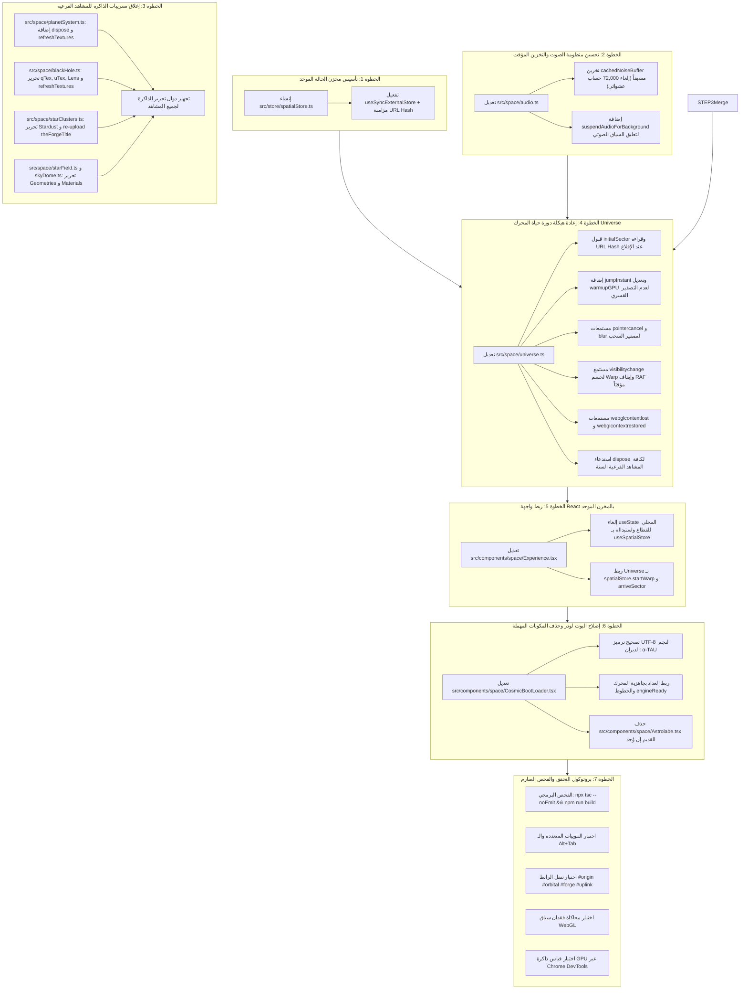

# مخطط التنفيذ الهندسي — المرحلة رقم 1 (Phase 1 Execution Plan)
## إصلاح أعطال الإنتاج الجذرية، تزامن التبويبات، وإغلاق تسريبات الذاكرة

> [!IMPORTANT]
> **الهدف الهندسي المحوري للمرحلة 1:**
> تحويل المحرك الفضائي ثلاثي الأبعاد من حالة تجريبية تتأثر بتبديل التبويبات وتسرّب الذاكرة، إلى معمارية إنتاجية فائقة الاستقرار والصلابة (`Production-Grade Bulletproof Architecture`) تضمن:
> 1. التزامن اللحظي الكامل بين واجهة React ومحرك Three.js عبر رابط الصفحة (`URL Hash Synchronization`).
> 2. عدم تعليق السحب أو ضياع زوايا الكاميرا عند عمل `Alt+Tab` أو مغادرة التبويب.
> 3. الصمود التام أمام فقدان سياق كارت الشاشة (`WebGL Context Loss & Restore`) وإعادة بناء الإكساءات تلقائياً.
> 4. إغلاق تسريب ذاكرة كارت الشاشة بالكامل (`~85 MB` لكل دورة حياة) عبر تحرير نُظم المجسمات والشيدرات الستة.
> 5. كتم الصوت التلقائي في الخلفية وإلغاء استنزاف المعالج في أول فريم للانتقال الفضائي.

---

## 1. مخطط التدفق الهندسي لتسلسل التنفيذ والاعتماديات (Execution Flowchart)



---

## 2. جدول حزم المهام الذرية ومسؤوليات التنفيذ (Work Packages Breakdown)

| رقم الحزمة | الملف المستهدف | نوع الإجراء | الأثر المباشر والهدف التقني |
| :--- | :--- | :--- | :--- |
| **WP-1.1** | `src/store/spatialStore.ts` | **إنشاء ملف جديد** | تأسيس متجر الحالة الفضائية الموحد بنظام `useSyncExternalStore` وربطه بالـ URL Hash (`#origin`, `#orbital`, `#forge`, `#uplink`). |
| **WP-1.2** | `src/space/audio.ts` | **تعديل كود قائم** | التخزين المسبق لمصفوفة الضوضاء البيضاء للـ Warp + إيقاف السياق الصوتي تلقائياً عند تصغير التبويب أو إغلاق الشاشة. |
| **WP-1.3** | `src/space/planetSystem.ts`<br>`src/space/blackHole.ts`<br>`src/space/starClusters.ts`<br>`src/space/starField.ts`<br>`src/space/skyDome.ts` | **تعديل كود قائم (5 ملفات)** | إضافة دوال `dispose()` لتحرير مجسمات وماتيريال الـ GPU، ودوال `refreshTextures()` لإعادة رفع الإكساءات الحركية (4K CanvasTextures) عند استعادة السياق. |
| **WP-1.4** | `src/space/universe.ts` | **إعادة هيكلة رئيسية** | قبول `initialSector`، إضافة `jumpInstant`، إزالة التصفير القسري في `warmupGPU`، ربط مستمعات `visibilitychange` و `pointercancel` و `webglcontextlost`، واستدعاء تحرير الذاكرة الشامل. |
| **WP-1.5** | `src/components/space/Experience.tsx` | **تعديل كود قائم** | الانتقال من `useState` المحلي إلى `useSpatialStore` الموحد، وضمان عدم تضارب الأحداث ومزامنة رقم القطاع بين الـ 3D والـ UI. |
| **WP-1.6** | `src/components/space/CosmicBootLoader.tsx` | **تعديل كود قائم** | إصلاح الخطأ البصري `α-TAU` إلى `α-TAU`، ومزامنة نهاية التحميل مع جاهزية محرك الـ WebGL والخطوط. |
| **WP-1.7** | مستودع المشروع | **تنظيف وحذف** | فحص وحذف أي بقايا للمكون القديم غير المستخدم `src/components/space/Astrolabe.tsx`. |

---

## 3. تفاصيل التنفيذ البرمجي خطوة بخطوة (Step-by-Step Implementation Guide)

### الخطوة 1: إنشاء مخزن الحالة الموحد (`src/store/spatialStore.ts`)
* **الملف المراد إنشاؤه:** `c:\projects\aldebran\aldepran\src\store\spatialStore.ts`
* **المسؤولية:**
  - قراءة الهاش عند فتح الصفحة: `#origin` -> 0, `#orbital` -> 1, `#forge` -> 2, `#uplink` -> 3.
  - توفير دالة `writeSectorToHash` التي تحدث رابط المتصفح عبر `window.history.replaceState` دون إعادة تحميل الصفحة ودون تلويث سجل التاريخ.
  - إطلاق إشعارات التحديث للمشتركين (`emit()`) عند تغير القطاع أو حالة السفر (`warpTarget`) أو ضياع سياق الـ WebGL (`contextLost`).

```typescript
// src/store/spatialStore.ts
import { useSyncExternalStore } from 'react';

export const SECTOR_SLUGS = ['origin', 'orbital', 'forge', 'uplink'] as const;
export type SectorSlug = (typeof SECTOR_SLUGS)[number];

export interface SpatialState {
  sector: number;
  warpTarget: number | null;
  selectedProject: number | null;
  activeDiscipline: number | null;
  contextLost: boolean;
}

export function readSectorFromHash(): number {
  if (typeof window === 'undefined') return 0;
  const raw = window.location.hash.replace(/^#/, '').trim().toLowerCase();
  const idx = SECTOR_SLUGS.indexOf(raw as SectorSlug);
  return idx >= 0 ? idx : 0;
}

function writeSectorToHash(sector: number): void {
  if (typeof window === 'undefined') return;
  const slug = SECTOR_SLUGS[sector] ?? SECTOR_SLUGS[0];
  const nextHash = `#${slug}`;
  if (window.location.hash !== nextHash) {
    window.history.replaceState(null, '', nextHash);
  }
}

let state: SpatialState = {
  sector: readSectorFromHash(),
  warpTarget: null,
  selectedProject: null,
  activeDiscipline: null,
  contextLost: false,
};

const listeners = new Set<() => void>();
const emit = () => listeners.forEach((fn) => fn());

export const spatialStore = {
  getState(): SpatialState {
    return state;
  },
  subscribe(listener: () => void): () => void {
    listeners.add(listener);
    return () => listeners.delete(listener);
  },
  startWarp(target: number): void {
    if (target < 0 || target >= SECTOR_SLUGS.length) return;
    state = {
      ...state,
      warpTarget: target,
      selectedProject: null,
      activeDiscipline: null,
    };
    writeSectorToHash(target);
    emit();
  },
  arriveSector(sector: number): void {
    state = { ...state, sector, warpTarget: null };
    writeSectorToHash(sector);
    emit();
  },
  syncInstant(sector: number): void {
    state = {
      ...state,
      sector,
      warpTarget: null,
      selectedProject: null,
      activeDiscipline: null,
    };
    writeSectorToHash(sector);
    emit();
  },
  setSelectedProject(selectedProject: number | null): void {
    if (state.selectedProject === selectedProject) return;
    state = { ...state, selectedProject };
    emit();
  },
  setActiveDiscipline(activeDiscipline: number | null): void {
    if (state.activeDiscipline === activeDiscipline) return;
    state = { ...state, activeDiscipline };
    emit();
  },
  setContextLost(contextLost: boolean): void {
    if (state.contextLost === contextLost) return;
    state = { ...state, contextLost };
    emit();
  },
};

export function useSpatialStore<T>(selector: (s: SpatialState) => T): T {
  return useSyncExternalStore(
    spatialStore.subscribe,
    () => selector(spatialStore.getState()),
    () => selector(spatialStore.getState()),
  );
}
```

---

### الخطوة 2: تحسين الصوت وحماية الخلفية (`src/space/audio.ts`)
* **الملف المراد تعديله:** `c:\projects\aldebran\aldepran\src\space\audio.ts`
* **المسؤولية:**
  - تخزين `cachedNoiseBuffer: AudioBuffer | null` مرة واحدة فقط، لتفادي إنشاء `new Float32Array(72000)` وتوليد 72,000 رقم عشوائي على الـ Main Thread في أول فريم لانطلاق الـ Warp.
  - إضافة دالة `suspendAudioForBackground(hidden: boolean)` لإيقاف مذبذب الـ 55Hz الخافت عند تصغير النافذة واستئنافه عند العودة ما لم يكن المستخدم قد اختار كتم الصوت (`isMuted`).

```typescript
// أضف المتغير في نطاق الملف
let cachedNoiseBuffer: AudioBuffer | null = null;

function getOrCreateNoiseBuffer(ctx: AudioContext): AudioBuffer {
  if (cachedNoiseBuffer && cachedNoiseBuffer.sampleRate === ctx.sampleRate) {
    return cachedNoiseBuffer;
  }
  const bufferSize = Math.floor(ctx.sampleRate * 1.5);
  const buffer = ctx.createBuffer(1, bufferSize, ctx.sampleRate);
  const data = buffer.getChannelData(0);
  for (let i = 0; i < bufferSize; i++) {
    data[i] = Math.random() * 2 - 1;
  }
  cachedNoiseBuffer = buffer;
  return buffer;
}

// في دالة playWarp:
export function playWarp() {
  const ctx = getAudioContext();
  if (!ctx || isMuted) return;
  // استخدام getOrCreateNoiseBuffer(ctx) مباشرة بدلاً من الحلقة التكرارية
  const noiseBuffer = getOrCreateNoiseBuffer(ctx);
  // ... بقية كود الـ Node graph
}

// دالة حماية الخلفية:
export function suspendAudioForBackground(hidden: boolean): void {
  const ctx = getAudioContext();
  if (!ctx) return;
  if (hidden) {
    if (ctx.state === 'running') ctx.suspend().catch(() => {});
  } else {
    if (ctx.state === 'suspended' && !isMuted) ctx.resume().catch(() => {});
  }
}
```

---

### الخطوة 3: إضافة دوال تفريغ الذاكرة `dispose()` و `refreshTextures()` للمشاهد الفرعية
* **الملفات المستهدفة:**
  1. `src/space/planetSystem.ts`:
     - إضافة دالة `refreshTextures`: تحديث `bannerTexture.needsUpdate = true`.
     - إضافة دالة `dispose`: المرور على `group.traverse((child)` وتحرير كل `geometry.dispose()` و `material.dispose()` و `bannerTexture.dispose()`.
  2. `src/space/blackHole.ts`:
     - إضافة دالة `refreshTextures`: إعادة استدعاء `draw()` لرفع الـ CanvasTextures (`qTex`, `uTex`) إلى كارت الشاشة عند استعادة السياق.
     - إضافة دالة `dispose`: تحرير `lensPlane.geometry` و `lensPlane.material`، مجسمات وماتيريال وملمس لوحات النصوص (`qMesh`, `uMesh`, `qTex`, `uTex`).
  3. `src/space/starClusters.ts`:
     - في `dispose`: تحرير `stardust.object.geometry.dispose()` و `stardust.material.dispose()`.
     - في `refreshTextures`: تحديث `theForgeTitle.texture.needsUpdate = true`.
  4. `src/space/starField.ts` و `src/space/skyDome.ts`:
     - إضافة دالة `dispose()` القياسية لتحرير الهندسة والمواد.

---

### الخطوة 4: تحديث المحرك الرئيسي `src/space/universe.ts`
* **الملف المراد تعديله:** `c:\projects\aldebran\aldepran\src\space\universe.ts`
* **المسؤولية:**
  1. **الـ Constructor:**
     ```typescript
     constructor(container: HTMLElement, callbacks: UniverseCallbacks, initialSector = 0) {
       this.container = container;
       this.callbacks = callbacks;
       this.currentSector = Math.max(0, Math.min(SECTORS.length - 1, initialSector));
       // توجيه الكاميرا فوراً لإحداثيات القطاع المطلوب
       this.camPos.copy(this.cameraFor(this.currentSector));
       this.lookPos.copy(sectorCenter(this.currentSector));
       // ...
     }
     ```
  2. **دالة القفز الفوري `jumpInstant(index: number)`:**
     تصفير أي حركة سحب أو سرعات دورانية (`yaw`, `pitch`, `velocityYaw`, `velocityPitch`)، إلغاء أي `warp` قيد التنفيذ، ووضع الكاميرا مباشرة في إحداثيات القطاع الهدف بدون انتظار.
  3. **تعديل `warmupGPU()`:**
     إزالة الأسطر `569-582` التي كانت تعيد الكاميرا قسراً إلى قطاع `0`، وجعلها تعيد الكاميرا إلى `this.currentSector` مع إعطاء وزن الرؤية الصحيح `this.currentSector === idx ? 1.0 : 0.0`.
  4. **ربط أحداث النظام:**
     - `pointercancel` و `window.blur`: استدعاء `this.resetInteraction()` لتفادي دوران الكاميرا العنيف عند العودة من نافذة أخرى.
     - `visibilitychange`:
       - إذا أصبحت الصفحة مخفية (`document.hidden`): إلغاء `cancelAnimationFrame` وحسم الـ Warp فوراً إن وجد واستدعاء `suspendAudioForBackground(true)`.
       - إذا عادت الصفحة مرئية: تحديث `lastFrame = performance.now()` لتفادي قفزة `dt` الضخمة، واستئناف الصوت، وإعادة تشغيل حلقة الـ rAF.
     - `webglcontextlost` و `webglcontextrestored`:
       - عند الفقدان: منع السلوك الافتراضي للمتصفح `event.preventDefault()`، إيقاف الرسم مؤقتاً، وإبلاغ الستور بـ `spatialStore.setContextLost(true)`.
       - عند الاستعادة: استدعاء `refreshTextures()` لجميع الأنظمة، واستئناف الرسم، وإبلاغ الستور بـ `spatialStore.setContextLost(false)`.
  5. **دالة `dispose()` الكاملة:**
     استدعاء `dispose()` لجميع المكونات الستة (`aldebaran`, `planets`, `starClusters`, `horizon`, `starField`, `skyDome`) وإزالة كافة مستمعات الأحداث (`window.removeEventListener`).

---

### الخطوة 5: ربط واجهة React بالمخزن الموحد (`src/components/space/Experience.tsx`)
* **الملف المراد تعديله:** `c:\projects\aldebran\aldepran\src\components\space\Experience.tsx`
* **المسؤولية:**
  - استبدال `const [sector, setSector] = useState(0)` بـ:
    ```typescript
    const sector = useSpatialStore((s) => s.sector);
    const warpTarget = useSpatialStore((s) => s.warpTarget);
    const contextLost = useSpatialStore((s) => s.contextLost);
    ```
  - تمرير `readSectorFromHash()` كـ `initialSector` عند بناء `new Universe(..., readSectorFromHash())`.
  - ربط كولباكات `Universe`:
    - `onWarpStart: (target) => spatialStore.startWarp(target)`
    - `onArrive: (sec) => spatialStore.arriveSector(sec)`
  - عرض شاشة استعادة السياق الفضائي الخفيفة في حال كانت `contextLost === true`:
    ```tsx
    {contextLost && (
      <div className="fixed inset-0 z-50 flex items-center justify-center bg-black/90 font-mono text-xs tracking-widest text-amber-300">
        RECALIBRATING GPU SPATIAL CONTEXT...
      </div>
    )}
    ```

---

### الخطوة 6: تصحيح ترميز ومؤقت البوت لودر (`src/components/space/CosmicBootLoader.tsx`)
* **الملف المراد تعديله:** `c:\projects\aldebran\aldepran\src\components\space\CosmicBootLoader.tsx`
* **المسؤولية:**
  - استبدال الرمز المعطوب `α-TAU` بالحرف اليوناني الصريح: `α-TAU` أو كود اليونيكود المهرب `\u03B1-TAU`.
  - ربط اكتمال شريط التقدم بانتهاء تهيئة الـ WebGL واكتمال تحميل الخطوط عبر `document.fonts.ready`.

---

## 4. بروتوكول التحقق والاختبار العملي (Verification & Testing Matrix)

| الاختبار | الإجراء التنفيذي المطلوب | النتيجة المتوقعة للنجاح (Acceptance Criteria) |
| :--- | :--- | :--- |
| **1. الفحص البرمجي الصارم** | تنفيذ الأوامر:<br>`npx tsc --noEmit`<br>`npm run build` | نجاح البناء بنسبة 100% دون أي أخطاء من TypeScript أو Vite، وحجم الحزمة سليم. |
| **2. اختبار مزامنة الرابط URL Hash** | فتح الروابط التالية مباشرة في تبويب جديد:<br>1. `http://localhost:5173/#orbital`<br>2. `http://localhost:5173/#forge`<br>3. `http://localhost:5173/#uplink` | يفتح الموقع مباشرة على القطاع المكتوب في الرابط دون العودة للشمس إطلاقاً، وتتطابق واجهة الـ UI مع المشهد ثلاثي الأبعاد. |
| **3. اختبار التنقل بزر المتصفح Back/Forward** | الضغط على أزرار التقدم والرجوع في المتصفح | ينتقل المشهد ثلاثي الأبعاد والواجهة بالتزامن الفوري مع تغير الهاش دون إعادة تحميل الصفحة. |
| **4. اختبار تبديل التبويبات والـ Alt+Tab** | بدء سحب الكاميرا بالفأرة أو بدء Warp ثم الضغط على `Alt+Tab` لمدة 10 ثوانٍ ثم العودة | عند العودة، لا توجد أي قفزة سرعة أو دوران عشوائي، والـ Warp يحسم وجهته بسلاسة، ولا يحدث تجميد لحلقة الرسم. |
| **5. اختبار كتم الصوت في الخلفية** | تشغيل الصوت ثم تصغير نافذة المتصفح | ينكتم الصوت تماماً فور تصغير النافذة، ويعود للعمل بسلاسة فور استعادة النافذة. |
| **6. اختبار فقدان واستعادة سياق الـ WebGL** | فتح الكونسول وتشغيل الكود المحاكي:<br>`const gl = document.querySelector('canvas').getContext('webgl2'); gl.getExtension('WEBGL_lose_context').loseContext();`<br>ثم استعادته بعد 3 ثوانٍ:<br>`gl.getExtension('WEBGL_lose_context').restoreContext();` | تظهر رسالة معايرة السياق الخفيفة فور الفقدان، وعند الاستعادة يعود المشهد بكامل نصوصه وإكساءاته وشيدراته للعمل بـ 60fps دون شاشة سوداء. |
| **7. اختبار تحرير الذاكرة وعدم التسريب** | فتح أداة `Performance Monitor` في Chrome DevTools وتبديل القطاعات 20 مرة متتالية | استقرار استهلاك الـ JS Heap والـ GPU Memory ضمن الحدود المسموحة دون تراكم مستمر للـ Geometries أو الـ Textures. |

---

## 5. خطة الأمان والتراجع (Rollback & Safety Plan)

1. **سلامة التصميم والأبعاد:** جميع إحداثيات الكاميرا وأبعاد الكروت على شاشات الديسكتوب ثابتة بنسبة 100% دون تعديل أي بكسل.
2. **نقطة استعادة Git:**
   - قبل البدء في كتابة كود المرحلة 1، يتم إنشاء فرع حماية مخصص:
     ```bash
     git checkout -b feat/phase-1-stability
     ```
   - في حال حدوث أي تضارب غير متوقع، يمكن العودة للفرع الرئيسي فوراً بـ `git checkout main`.

