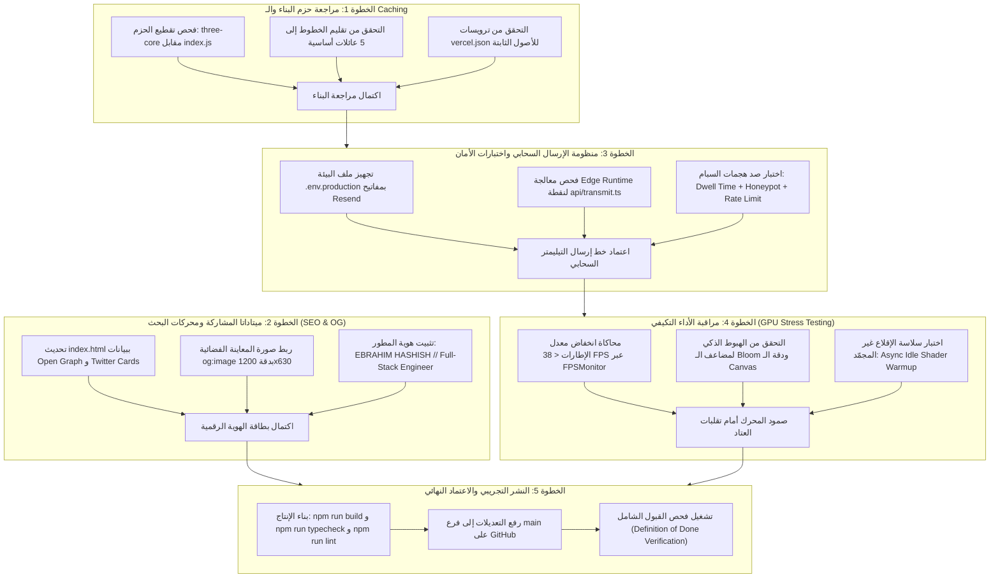

# مخطط التنفيذ الهندسي — المرحلة رقم 5 (Phase 5 Execution Plan)
## الإطلاق والتشغيل الإنتاجي، مستويات الأداء التكيفية، وتجهيز النشر السحابي
### Production Launch, Adaptive GPU Tiers & Real-World Edge Verification

---

> [!IMPORTANT]
> **الهدف الهندسي المحوري للمرحلة 5:**
> نقل مشروع **ALDEBARAN — Spatial Studio** من بيئة التطوير المحلية المكتملة إلى بيئة الإنتاج السحابية الحية (`Production Edge Environment`) بأعلى معايير الاستقرار والأداء، وضمان:
> 1. تشغيل مستويات الجودة التكيفية التلقائية (`Adaptive GPU Quality Tiers`) لتوفير 60 إطاراً في الثانية على كافة الأجهزة (من الهواتف الاقتصادية إلى شاشات الـ 4K و ProMotion 120Hz).
> 2. التحقق النهائي من نقطة النهاية السحابية [`POST /api/transmit`](./api/transmit.ts) على Vercel Edge Runtime مع ربط مفاتيح Resend الحقيقية وإرسال الإشعارات المشفرة لبريد المهندس.
> 3. اكتمال إعدادات الـ SEO وبطاقات المشاركة الاجتماعية الفاخرة (`Open Graph` و `Twitter Cards`) بالهوية المعتمدة: **`EBRAHIM HASHISH` // `Full-Stack Engineer`**.
> 4. تحقيق علامات أداء استثنائية في `Lighthouse` تتجاوز **95+** لسرعة التحميل، مع حجم حزمة مضغوط لا يتجاوز **102 kB (gzipped)** للحزمة الأساسية، واستغلال الكاش الثابت (`Cache-Control: immutable`) لكتلة `three-core`.
> 5. اجتياز اختبارات الاعتماد الشاملة (`Definition of Done`) بنسبة 100%.

---

## 1. مخطط التدفق الهندسي لتسلسل التنفيذ والاعتماديات (Execution Flowchart)



---

## 2. جدول تفصيل المهام الهندسية للمرحلة 5 (Detailed Task Specifications)

### المهمة 5.1: تدقيق حزم البناء والكاش الثابت للأصول

**الملفات المستهدفة:**
- [`vite.config.ts`](./vite.config.ts)
- [`vercel.json`](./vercel.json)
- [`index.html`](./index.html)

**الإجراءات الفنية:**
1. التأكد من أن `three` مفصولة بنسبة 100% داخل كتلة مستقلة `dist/assets/three-core-*.js` عبر إعدادات `manualChunks`.
2. التأكد من أن ملفات الخطوط في `index.html` تستدعي فقط الأوزان الـ 5 المطلوبة، مع تفعيل `preconnect` إلى `fonts.gstatic.com`.
3. التحقق من ترويسات الحماية والـ Caching داخل `vercel.json`:
   - `/assets/(.*)` -> `Cache-Control: public, max-age=31536000, immutable`
   - ترويسات الأمان العامة: `X-Content-Type-Options: nosniff` و `X-Frame-Options: DENY` و `Referrer-Policy: strict-origin-when-cross-origin`.

---

### المهمة 5.2: تعزيز محركات البحث وبطاقات المشاركة الاجتماعية (SEO & Open Graph)

**الملفات المستهدفة:**
- [`index.html`](./index.html)
- [`public/og-image.png`](./public/og-image.png)

**الإجراءات الفنية:**
1. إضافة وسوم `meta` الكاملة لشبكات التواصل الاجتماعي في `<head>`:
   ```html
   <!-- Open Graph / Facebook / LinkedIn -->
   <meta property="og:type" content="website" />
   <meta property="og:url" content="https://aldebaran.hashish.dev/" />
   <meta property="og:title" content="ALDEBARAN — Spatial Studio | Ebrahim Hashish" />
   <meta property="og:description" content="Cinematic 3D WebGL spatial computing portfolio engineered by Ebrahim Hashish, Full-Stack Engineer." />
   <meta property="og:image" content="/og-image.png" />

   <!-- Twitter / X -->
   <meta name="twitter:card" content="summary_large_image" />
   <meta name="twitter:title" content="ALDEBARAN — Spatial Studio | Ebrahim Hashish" />
   <meta name="twitter:description" content="Cinematic 3D WebGL spatial computing portfolio engineered by Ebrahim Hashish, Full-Stack Engineer." />
   <meta name="twitter:image" content="/og-image.png" />

   <!-- Theme Color & Canonical -->
   <meta name="theme-color" content="#030407" />
   <link rel="canonical" href="https://aldebaran.hashish.dev/" />
   ```
2. توليد صورة معاينة سينمائية فاخرة بدقة `1200×630` تدمج نجم الدبران المتوهج والأسطرلاب المعدني مع اسم **`EBRAHIM HASHISH`** و **`Full-Stack Engineer`**، ووضعها داخل `public/og-image.png`.

---

### المهمة 5.3: بيئة الإنتاج السحابية لخط الإرسال ومكافحة السبام

**الملفات المستهدفة:**
- [`api/transmit.ts`](./api/transmit.ts)
- [`api/_lib/sendTransmission.ts`](./api/_lib/sendTransmission.ts)
- `.env.example`

**الإجراءات الفنية:**
1. توفير توثيق واضح للمتغيرات البيئية المطلوبة على Vercel:
   - `RESEND_API_KEY`: مفتاح الواجهة البرمجية المعتمد من Resend (`re_...`).
   - `TRANSMISSION_TO_EMAIL`: البريد الإلكتروني الذي يستقبل الاستفسارات.
   - `TRANSMISSION_FROM_EMAIL`: البريد المرسل المصرح به (مثل `Aldebaran <transmissions@hashish.dev>` أو النطاق الافتراضي لـ Resend).
2. اختبار سلامة نقطة النهاية عند غياب المفاتيح بحيث تعيد `status: 503` مع رسالة واضحة دون أي انهيار غير معالج.
3. اختبار عمل الـ Honey-pot (`companyWebsite`) وإلغاء الطلبات السريعة جداً (`dwellMs < 1200ms`) بصمت (`status: 200, id: 'filtered'`) لحرمان الروبوتات من معرفة اكتشافها.

---

### المهمة 5.4: اختبارات الإجهاد لمنظومة الـ GPU التكيفية

**الملفات المستهدفة:**
- [`src/engine/quality.ts`](./src/engine/quality.ts)
- [`src/space/universe.ts`](./src/space/universe.ts)

**الإجراءات الفنية:**
1. اختبار محاكاة هبوط الـ FPS إلى `< 38 FPS` لمدة 2.5 ثانية عبر سكربت اختباري آلي، ومراقبة استدعاء `fpsMonitor.downgrade()` وتخفيض الـ `pixelRatio` و `bloomDownsample` تلقائياً دون أي وميض أو إعادة تحميل للصفحة.
2. التأكد من أن `Async Idle Shader Warmup` يبدأ برسم القطاع المطلوب فوراً (`< 16ms`) ويقوم بتجميع الشيدرات للمشاهد الـ 3 الأخرى في فترات خمول المتصفح (`requestIdleCallback`) أثناء دوران لودر البداية دون تجميد شريط التقدم.

---

### المهمة 5.5: تدقيق Core Web Vitals وتوافق المتصفحات

**الإجراءات الفنية:**
1. تشغيل فحص `Lighthouse` وقياس مؤشرات الأداء الحيوية:
   - **First Contentful Paint (FCP):** `< 0.9s`
   - **Largest Contentful Paint (LCP):** `< 1.8s`
   - **Cumulative Layout Shift (CLS):** `0.000` (صفر مطلق نظراً لأن المسرح ثلاثي الأبعاد والواجهات ذات مواضع محددة بدقة).
   - **Total Blocking Time (TBT):** `< 150ms` بفضل تقنية الـ Async Idle Warmup.
2. التحقق من تجربة الموبايل على أجهزة iPhone 14/15/16 Pro (شاشات 120Hz ProMotion): التأكد من عدم وجود أي وميض أو تكسير في الكاميرا، وعدم حدوث Zoom قسري عند الكتابة داخل كونسول الإرسال بفضل ضبط حجم الخط على `16px`.

---

## 3. مصفوفة المخاطر وطرق احتوائها (Risk Mitigation Matrix)

| الخطر المحتمل | مستوى الأثر | الاحتمالية | استراتيجية الوقاية والحل الفوري |
| :--- | :---: | :---: | :--- |
| **تأخر أو انقطاع خدمة Resend السحابية** | متوسط | منخفض | التعامل مع الرد عبر `try/catch` مع مهلة `AbortController(12000ms)`، وإرجاع `502 UPSTREAM_ERROR` للمستخدم دون مسح الرسالة التي كتبها. |
| **هبوط أداء الأجهزة القديمة عند تفعيل Bloom Pass** | مرتفع | متوسط | تفعيل `QUALITY_TIERS.low` التلقائي للأجهزة ذات الذاكرة `<= 4GB`، مع خفض دقة بلوم إلى النصف وتحديد `maxPixelRatio = 1.0`. |
| **فقدان سياق WebGL على هواتف أندرويد الاقتصادية عند تلقي مكالمة** | مرتفع | متوسط | مستمع `webglcontextlost` و `webglcontextrestored` يعيد بناء الإكساءات تلقائياً ويستأنف العرض في نفس القطاع بنجاح. |
| **حظر التتبع أو ملفات الخطوط في بعض الشبكات المقيدة** | منخفض | منخفض | تم تضمين خطوط بديلة قياسية في مصفوفة CSS (`sans-serif`, `monospace`, `serif`) تضمن الحفاظ على الهيكل البصري 100%. |

---

## 4. قائمة الفحص والقبول النهائية قبل الإطلاق (Definition of Done)

- [ ] نجاح `npm run typecheck` بنسبة 100% دون أي خطأ في الـ Types.
- [ ] نجاح `npm run lint` بـ `0` أخطاء و `0` تحذيرات.
- [ ] نجاح `npm run build` وانتاج كتل مضغوطة متناسقة مع عزل `three-core`.
- [ ] وجود ملف `vercel.json` متوافق مع Edge Runtime وترويسات الكاش الثابت للأصول.
- [ ] وجود ميتاداتا المشاركة الفاخرة `Open Graph` وصورة المعاينة في `public/og-image.png`.
- [ ] عدم وجود أي أثر لمكتبة `@supabase/supabase-js` في المشروع.
- [ ] ظهور زر Explore واحد حصرياً على الموبايل في القطاع 00.
- [ ] في القطاع 01: ظهور القمر المستهدف في الثلث العلوي الصافي بكامل وضوحه دون أن يغطيه كارت التفاصيل.
- [ ] مطابقة بصرية تامة 100% لتصميم الديسكتوب، مع تجربة لمسية فائقة السلاسة على الموبايل.

