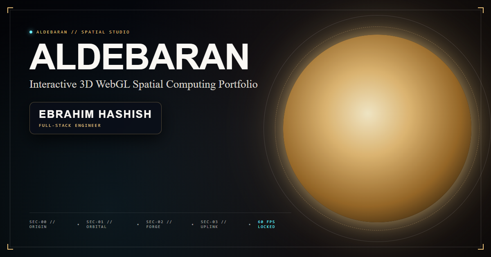
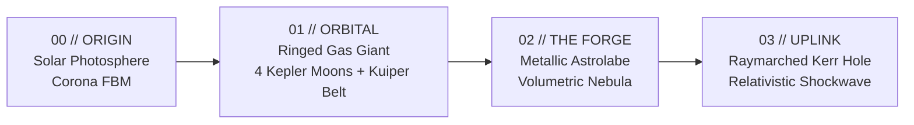

<div align="center">

# ALDEBARAN
### World-Class 3D Spatial Studio & Computational Engine

[](./LICENSE)
[](https://www.typescriptlang.org/)
[](https://threejs.org/)
[](https://ebrahimelkordy.github.io/aldebaran/)
[](https://ebrahimelkordy.github.io/aldebaran/)

<p align="center">
  <b>A continuous, zero-jank 3D WebGL spatial universe pairing relativistic astrophysical physics with bespoke double-walled aerospace HUD glass interfaces.</b>
</p>

<p align="center">
  <a href="https://ebrahimelkordy.github.io/aldebaran/"><strong>Explore Live Platform ↗</strong></a> &bull;
  <a href="#-commercial-context--status"><strong>Production Context</strong></a> &bull;
  <a href="#-spatial-sectors-architecture"><strong>Sectors Architecture</strong></a> &bull;
  <a href="#-engineering-innovations"><strong>Engineering Highlights</strong></a> &bull;
  <a href="#-dual-tier-projects-architecture"><strong>Projects Matrix</strong></a>
</p>

---



</div>

---

## 🛰️ Commercial Context & Status

> [!IMPORTANT]
> **Status: Commercial Client Commission — Unreleased Production Build**  
> This platform was commissioned, architected, and engineered to 100% production readiness for an enterprise spatial studio. Prior to public commercial rollout, communication from the commissioning entity was abruptly discontinued for undisclosed internal reasons.  
> 
> Rather than letting months of advanced computational engineering, custom GLSL raymarching, and spatial UI architecture sit dormant, the entire production build and source code have been deployed, open-sourced, and documented here in full fidelity by its creator.

---

## 🌌 Architectural Philosophy & Visual Constitution

Aldebaran abandons the antiquated paradigm of vertical flat-page scrolling. Instead, the application runs a **continuous WebGL spatial coordinate system** governed by physical celestial bodies, paired with a synchronized **Double-Walled Glass HUD (`forge-card` & `chamfer-clip`)** with hairline borders and champagne-gold photonic reflections.

### The Visual Tokens
* **The Cosmic Void:** `#030407` base, `#050811`, `#0A0D18`.
* **Stellar Champagne:** `#FFF4D0` (focus), `#EAC078`, `#DFB15B`, `#9E6C28`.
* **Aerospace Typography Matrix:**
  * **Headlines:** `Antonio` (700 bold, tracking `-0.015em`, line-height `0.85`).
  * **Editorial Narrative:** `Cormorant Garamond` (400/600 italic & roman).
  * **Telemetry Data:** `JetBrains Mono` (tracking `0.18em`–`0.28em`, prefixed with `//` or `01 // ...`).
  * **Functional UI:** `Inter` (300/400/500, soft `#D8D4CC`).

---

## 🪐 Spatial Sectors Architecture

The continuum is partitioned into four synchronized spatial sectors along an astronomical coordinate axis:



| Sector | Identifier | Physical Simulation & Visual Engineering |
| :---: | :--- | :--- |
| **`00`** | **ORIGIN** | Procedural solar photosphere driven by multi-octave 3D fractional Brownian motion (FBM), dual domain-warping, limb darkening, and filmic exposure tone-mapping. |
| **`01`** | **ORBITAL SYSTEMS** | Massive ringed gas giant accompanied by **4 distinct Keplerian lunar stations** with inclined orbital planes, paired with an outer **Kuiper Asteroid Belt** housing the deep engineering catalog. |
| **`02`** | **THE FORGE** | Multi-shell volumetric nebula shaders coupled with a procedurally generated, faceted metallic armillary astrolabe (`BufferGeometry` with split normals & anisotropic tangents). |
| **`03`** | **QUANTUM UPLINK** | Volumetric raymarched Kerr black hole with relativistic Doppler beaming, photon sphere gravitational lensing, and a **relativistic gravitational wave shockwave** featuring camera spring recoil. |

---

## ⚡ Key Engineering Highlights

### 1. Quantum Stellar Ignition Loader
* Replaces generic CSS loaders with an interactive HTML5 Canvas gravitational singularity engine.
* 220 golden stardust particles converging according to an inverse-square law ($F = G \cdot M / r^2$), paired with counter-rotating astrolabe reticles.
* Synchronized 100% to real hardware readiness: `document.fonts.ready` + non-blocking GPU shader compilation (`renderer.compile`).

### 2. Relativistic Gravitational Lensing Shockwave
* An advanced GLSL screen-space refractive wave replacing flat geometry rings.
* Physically separates light into Doppler blueshifted leading wavefronts and redshifted trailing wakes with chromatic dispersion and geometric energy attenuation.
* Triggers a damped harmonic oscillator camera recoil ($z(t) = -A \cdot e^{-\zeta \omega t} \cos(\omega t)$).
* Real-time Web Audio API synthesizer generating deep sub-bass dives (75Hz → 24Hz) and crystal resonance pings.

### 3. Dual-Tier Projects Architecture
* **Tier A (Sector 01 Orbital Flagships):** Clicking any moon preserves the live 3D celestial body in an elevated upper sky pocket while sliding in an architectural glass case study dossier with hard metrics, architectural narrative, technical challenges, and live endpoints.
* **Tier B (Outer Kuiper Asteroid Belt Catalog):** An outer particle ring orbiting beyond the moons, granting access to a full spatial grid of 6 distributed systems, shader labs, edge gateways, and database operators.

### 4. Single-Pass 60 FPS Anchor Bus
* World-to-screen coordinate projection decoupled from React rendering cycles.
* SVG telemetry lines and reticles update directly through lightweight DOM references in a dedicated single-pass frame loop, eliminating re-render overhead.

---

## 🛠️ Technology Stack Matrix

```text
┌────────────────────────────────────────────────────────────────────────┐
│                          ALDEBARAN STACK                               │
├───────────────────┬────────────────────────────────────────────────────┤
│ Framework & State │ React 18.3, TypeScript 5.5 (Strict), Zustand Store │
│ 3D & Graphics     │ Three.js r169, Custom GLSL Shaders, WebGL 2.0      │
│ Styling & Motion  │ Tailwind CSS 3.4, PostCSS, Custom Chamfer System   │
│ Audio Engine      │ Native Web Audio API (Synthesizers & Noise Nodes)   │
│ Build Tooling     │ Vite 7.3, Rollup Chunk Splitting, ESLint 9         │
│ CI / CD           │ GitHub Actions (Pages Automated Artifact Delivery) │
└───────────────────┴────────────────────────────────────────────────────┘
```

---

## 📂 Project Structure

```text
aldebaran/
├── .github/workflows/
│   └── deploy.yml              # Automated GitHub Pages CI/CD workflow
├── public/
│   ├── favicon.svg             # Vector stellar brand icon
│   └── og-image.png            # High-DPI 1200x630 OpenGraph social banner
├── src/
│   ├── components/
│   │   ├── sectors/orbital/
│   │   │   ├── OrbitalCaseStudyModal.tsx # Flagship moon architectural dossier
│   │   │   └── ProjectArchiveGrid.tsx    # Asteroid belt 3D catalog & specs
│   │   └── space/
│   │       ├── ArtifactsPanel.tsx        # Sector 01 Orbital HUD & leader lines
│   │       ├── CosmicBootLoader.tsx      # Canvas gravitational singularity loader
│   │       ├── CosmicCursor.tsx          # Dual-ring celestial reticle cursor
│   │       ├── Experience.tsx            # Master viewport & HUD compositor
│   │       ├── HorizonPanel.tsx          # Sector 00 Origin solar telemetry
│   │       ├── SystemsPanel.tsx          # Sector 02 The Forge disciplines
│   │       └── TransmissionPanel.tsx     # Sector 03 Quantum contact console
│   ├── engine/
│   │   ├── anchorBus.ts        # Single-pass screen coordinate projection
│   │   └── quality.ts          # Adaptive GPU performance & quality tiers
│   ├── space/
│   │   ├── audio.ts            # Procedural sub-bass & warp audio synthesizer
│   │   ├── blackHole.ts        # Kerr black hole mesh & accretion plane
│   │   ├── blackHoleShaders.ts # Volumetric geodesic raymarching GLSL
│   │   ├── content.ts          # Canonical Tier A & Tier B architectural data
│   │   ├── planetSystem.ts     # Ringed planet, Kepler moons & Kuiper belt
│   │   ├── shockwaveShader.ts  # Relativistic gravitational lensing shader
│   │   └── universe.ts         # Master Three.js engine & camera controller
│   └── store/
│       └── spatialStore.ts     # Reactive state & external sync store
├── MASTER_DESIGN_COMPETITION_PLAN.md # Architectural competition specification
└── vite.config.ts              # Production build & relative base configuration
```

---

## 🚀 Local Development & Build

### Prerequisites
* **Node.js:** `v20.x` or `v24.x`
* **npm:** `v10.x` or higher

```bash
# 1. Clone repository
git clone https://github.com/ebrahimelkordy/aldebaran.git
cd aldebaran

# 2. Install dependencies
npm install

# 3. Start local development server
npm run dev

# 4. Typecheck & lint validation
npm run typecheck
npm run lint

# 5. Production bundle build
npm run build

# 6. Preview production distribution locally
npm run preview
```

---

## 👨‍💻 Engineer & Architecture Authority

* **Engineer:** **Ebrahim Hashish** (`إبراهيم حشيش`)
* **Role:** **Full-Stack Engineer**
* **Live Deployment:** [https://ebrahimelkordy.github.io/aldebaran/](https://ebrahimelkordy.github.io/aldebaran/)
* **Repository:** [https://github.com/ebrahimelkordy/aldebaran](https://github.com/ebrahimelkordy/aldebaran)

---

<div align="center">
  <sub>Copyright &copy; 2026 Ebrahim Hashish. Released under the <a href="LICENSE">MIT License</a>.</sub>
</div>
